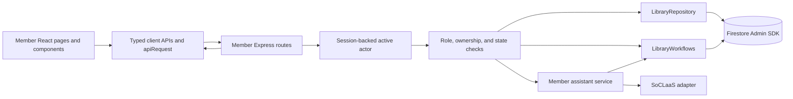
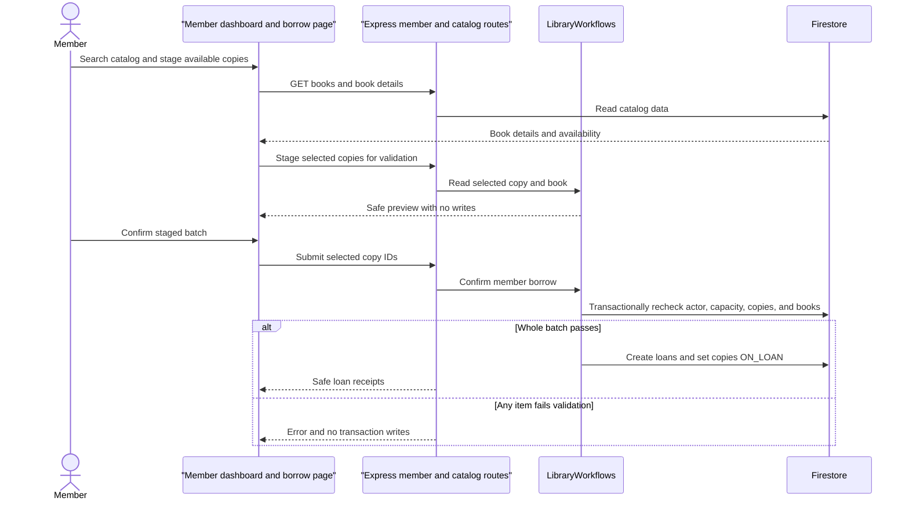
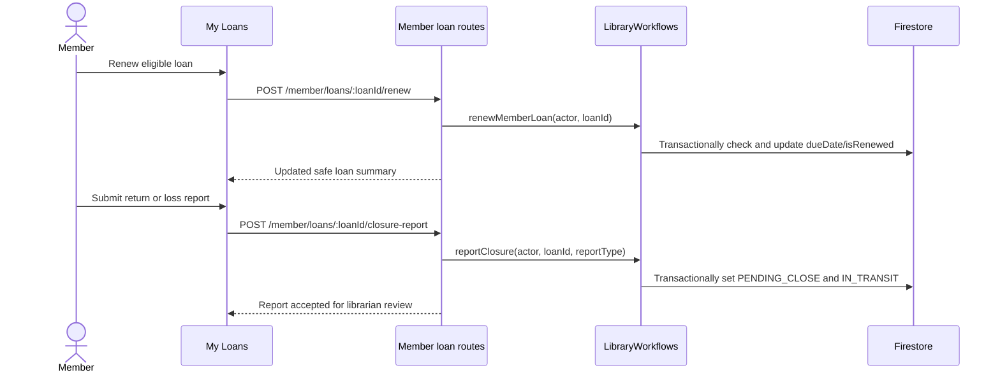
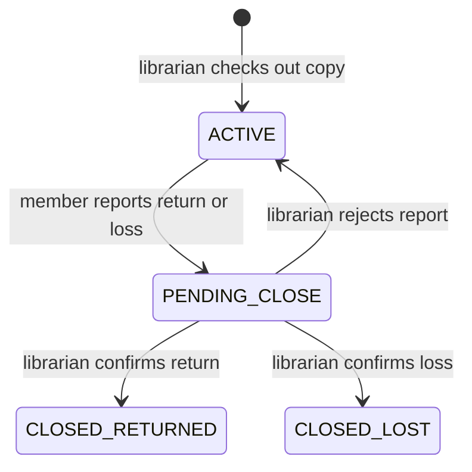
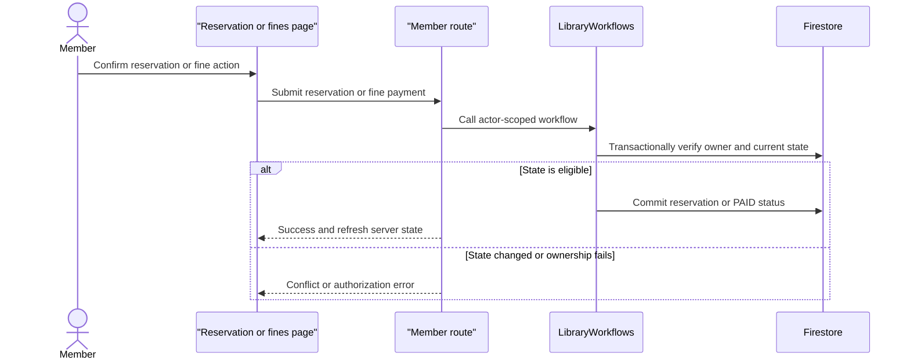
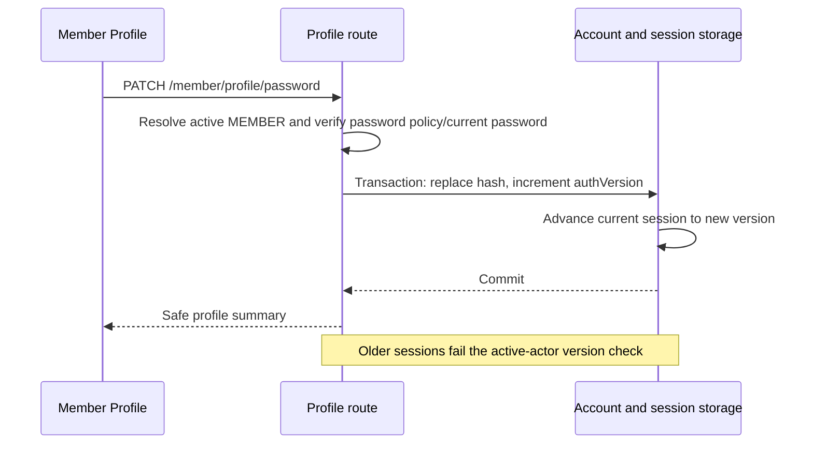

# Developer Guide

## Table of contents

- [Scope of this guide](#scope-of-this-guide)
- [Repository layout](#repository-layout)
- [Architecture and request flow](#architecture-and-request-flow)
- [Roles and authorization](#roles-and-authorization)
- [Domain state machines](#domain-state-machines)
- [Feature implementation map](#feature-implementation-map)
- [Catalog and inventory](#catalog-and-inventory)
- [Loans and return/loss review](#loans-and-returnloss-review)
- [Reservations, fines, and notifications](#reservations-fines-and-notifications)
- [Member-account support](#member-account-support)
- [Manager librarian-account administration](#manager-librarian-account-administration)
- [Librarian review assistant](#librarian-review-assistant)
- [Error, pagination, and transaction conventions](#error-pagination-and-transaction-conventions)
- [Local development and verification](#local-development-and-verification)
- [Multi-agent development workflow](#multi-agent-development-workflow)
- [How developers use the agents in Codex](#how-developers-use-the-agents-in-codex)
- [Human orchestration rules](#human-orchestration-rules)
- [Member features](#member-features)
- [Test Accounts](#test-accounts)
- [Acknowledgements](#acknowledgements)

## Scope of this guide

This guide documents the design and development process of LibConnect, an
integrated library application for members, librarians, and librarian
managers. It describes the current TypeScript/React/Express/Firestore
implementation, not only the planned product scope. The user-facing
walkthrough is in [`UserGuide.md`](./UserGuide.md).

The librarian and manager sections cover:

- catalog and physical-copy inventory management;
- librarian loan creation and return/loss closure review;
- reservation, fine, and notification operations;
- librarian support for member-account status changes;
- manager-only librarian-account administration and password resets; and
- the librarian/manager review assistant for pending reports and notification
  drafts.

The [Member features](#member-features) section covers member self-service:
catalog search, borrowing, loans and renewals, reservations, fines,
notifications, profile management, and the Libby member assistant. Both
feature areas share the same authentication, session, and storage layers.

## Repository layout

The application source code lives in the `src/` folder of each package:

| Path | Contents |
| --- | --- |
| `apps/api/src/` | Express API: routes, HTTP middleware, Firestore storage, AI services, and the SoCLaaS client |
| `apps/client/src/` | React client: pages, components, typed API clients, and authentication context |
| `apps/client/*.html`, `apps/client/auth-static.css` | Static no-JavaScript sign-in and registration pages |
| `packages/shared/src/` | Shared domain record types |
| `scripts/` | Development (`dev.mjs`), local manager bootstrap, and review-only deployment scripts |
| `tests/` | Unit, route, client, security, browser, and emulator tests |
| `firestore.rules`, `firestore.indexes.json`, `firebase.json`, `Dockerfile` | Firestore and deployment configuration |

`dist/` holds the compiled API and client output from `npm run build`. Source
files are formatted with Prettier (`npm run format`); `npm run format:check`
verifies formatting.

The files that support the agentic development workflow are:

| Path | Contents |
| --- | --- |
| `AGENTS.md` | Stable rules every coding agent follows: source-of-truth order, security baseline, boundaries, and the approval protocol |
| `workflow/README.md` | Workflow stages, handoff rules, the skill mapping, and the `specdocs` path adapter |
| `workflow/agents/` | Role procedures for the `spec-analyst`, `implementer`, and `reviewer-tester` agents |
| `workflow/templates/` | Templates for the task checklist, handoff, implementation report, review report, and security review |
| `workflow/tasks/<task-id>/` | Per-task evidence: spec snapshot, checklist, handoff, implementation report, review report, and security review |
| `Overview.md` | Product scope and domain vocabulary |
| `PLAN.md` | Approved dependency and delivery plan, including open approval gates |
| `PlanDraft/Specs/` | Canonical feature specifications for the librarian, manager, authentication, and integration work |
| `PlanDraft/Workflows/` | User-workflow drafts used as input to the specifications |
| `PlanDraft/Developer_Responsibilities/` | Feature ownership split between the two developers |
| `specdocs/` | SDD design and task documents produced for the member track (`completed/`) and SoCLaaS LLM usage notes |
| `.agents/skills/` | Agent skills used in the workflow: `sdd-design`, `sdd-propose`, `sdd-apply`, `sdd-revise`, `sdd-archive`, `ai-security-review`, `summarise-chat`, and `yeet` |
| `.agents/skills/junhong_skill_archive/` | Earlier skill versions and Codex agent configuration kept for reference |
| `logs/<task-id>/` | Factual execution logs for each workflow task |
| `docs/logs/<developer>/` | `summarise-chat` summaries of each developer's agent conversations |
| `docs/reflections/` | Individual reflections, linked from `docs/Reflections.md` |

## Architecture and request flow

The implementation follows one server-owned path for all consequential work:

```text
React page and typed API client
        -> Express route under /api/v1
        -> session actor + Zod request validation
        -> role/ownership/state policy
        -> repository or transactional workflow
        -> Firestore Admin SDK
```

The browser never writes Firestore directly. The current actor is resolved from
the session and reloaded from Firestore; client-supplied roles, manager flags,
ownership objects, status fields, timestamps, and confirmation values are not
authorization inputs. `ProtectedRoute` provides navigation-level usability,
but the Express middleware and storage/workflow checks remain authoritative.

The main source locations are:

| Layer | Files | Responsibility |
| --- | --- | --- |
| Client pages | `apps/client/src/pages/Librarian*.tsx`, `ManagerLibrarianAccountsPage.tsx` | Forms, queues, confirmation, loading/error/success states |
| Client API | `apps/client/src/api/catalog.ts`, `circulation.ts`, `members.ts`, `manager.ts`, `librarian-assistant.ts` | Typed request/response wrappers; credentials stay with the shared API client |
| HTTP routes | `apps/api/src/routes/catalog.ts`, `circulation.ts`, `reservations-fines.ts`, `librarian-members.ts`, `manager.ts`, `librarian-assistant.ts` | Route-level validation and role middleware |
| Domain/storage | `apps/api/src/storage/repositories.ts`, `accounts.ts`, `workflows.ts` | Firestore reads, transactions, invariants, side effects, safe DTO data |
| Shared records | `packages/shared/src/domain/records.ts` | Zod schemas and domain status vocabulary |
| AI boundary | `apps/api/src/ai/`, `apps/api/src/integrations/soclaas/client.ts` | Bounded context loading, provider calls, output validation, rate limits, fallback |

All business routes are mounted below `/api/v1` in `apps/api/src/server.ts`.
The server applies active-actor authentication to the business API before the
feature routers run. Auth routes are the only business-path exception.

## Roles and authorization

| Actor | Jiali-owned access |
| --- | --- |
| Active librarian | Catalog reads and writes, inventory summary, loan creation, pending closure review, reservation/fine queues, fine waiver, member support, messages, and AI assistant |
| Active manager | All active-librarian access plus librarian-account listing, activation/deactivation, and resetting another librarian's password |
| Active member | Shared catalog reads and the member-owned closure-report endpoint for their own active loans; no librarian operations |
| Inactive account | No protected business operation |
| Signed-out requester | No protected business operation |

`isManager` is server-controlled. Registration cannot create manager privilege.
Manager account changes use a transaction and prevent deactivation of the last
active manager. Deactivating an account revokes its sessions; if cleanup is
temporarily unavailable, the server keeps the account inactive and uses the
server-only revocation-job worker described in the manager section below.

## Domain state machines

The state transitions below are the invariants that the UI must not bypass.

```text
BookCopy:
  AVAILABLE -> ON_LOAN -> IN_TRANSIT -> AVAILABLE | DAMAGED | RESERVED
                                      \-> LOST
  RESERVED -> ON_LOAN                 (matching member pickup)

Loan:
  ACTIVE -> PENDING_CLOSE -> ACTIVE             (review rejected)
                         \-> CLOSED_RETURNED    (return confirmed)
                         \-> CLOSED_LOST        (loss confirmed)

Reservation:
  PENDING -> FULFILLED | CANCELLED | EXPIRED

Fine:
  OUTSTANDING -> PAID | WAIVED

Account:
  ACTIVE <-> INACTIVE
```

Loan creation, member closure reporting, closure review, fine waiver, member
status changes, manager status changes, reservation expiry, and notification
side effects use server-side checks. A stale or incompatible state returns a
validation, forbidden, not-found, or conflict error and does not silently
overwrite the newer state.

## Feature implementation map

| Feature | Client entry point | API implementation | Storage/workflow boundary |
| --- | --- | --- | --- |
| Catalog and inventory | `/librarian/catalog` | `catalog.ts` | `LibraryRepository` |
| Loans and closure review | `/librarian/circulation` | `circulation.ts` | `LibraryWorkflows` |
| Reservations, fines, messages | `/librarian/reservations-fines` | `reservations-fines.ts` | `LibraryWorkflows` plus trusted workers |
| Member account support | `/librarian/members` | `librarian-members.ts` | `AccountStorage` |
| Manager librarian accounts | `/librarian/manager/accounts` | `manager.ts` | `AccountStorage` and session store |
| Review assistant | `/librarian/assistant` | `librarian-assistant.ts` | `LibrarianAssistantService` and `SoCLlmClient` |

## Catalog and inventory

Active librarians can maintain book metadata and physical copies. Active
members and librarians can read catalog data. Circulation owns operational copy
statuses; catalog CRUD can create a copy as `AVAILABLE` and edit only its shelf
location. It must not be used to set `ON_LOAN`, `IN_TRANSIT`, `RESERVED`, or
`LOST`.

Book creation accepts an ISBN, title, author (one name or a bounded list),
publication year, publisher, category, and synopsis. Book updates are strict
partial updates and never change the ISBN or server timestamps. Copy creation
accepts only a shelf location and generates the copy ID server-side.

The catalog routes are:

| Method | Path | Access | Purpose |
| --- | --- | --- | --- |
| `GET` | `/books` | Active account | Bounded search by title, author, publisher, category, ISBN, year |
| `GET` | `/books/:isbn` | Active account | Book metadata, copies, and availability counts |
| `GET` | `/books/:isbn/copies` | Active account | Copies for one ISBN, optionally filtered by status |
| `GET` | `/copies` | Active account | Bounded copy search |
| `GET` | `/copies/:copyId` | Active account | One copy |
| `GET` | `/librarian/inventory/summary` | Active librarian | Title, copy, available, and per-status counts |
| `POST` | `/books` | Active librarian | Create a book |
| `PATCH` | `/books/:isbn` | Active librarian | Update editable book fields |
| `DELETE` | `/books/:isbn` | Active librarian | Delete a book when repository reference checks allow it |
| `POST` | `/books/:isbn/copies` | Active librarian | Add an available copy |
| `PATCH` | `/copies/:copyId` | Active librarian | Change shelf location |
| `DELETE` | `/copies/:copyId` | Active librarian | Delete an unreferenced/deletable copy |

List endpoints use bounded limits and signed cursors. Cursors are tied to the
search filters so a cursor from one query cannot be reused for another query.
Delete and parent/child creation operations use transactions to prevent
dangling books or copies and do not rewrite historical loan/fine/notification
records.

## Loans and return/loss review

`POST /librarian/loans` accepts only `{ memberId, copyId }`. The server requires
an active member, a lendable copy (`AVAILABLE`, or a matching non-expired
`RESERVED` copy), and an existing parent book. It generates the loan ID,
timestamps, and a 30-day due date, then changes the copy to `ON_LOAN` in one
transaction. A matching reservation becomes `FULFILLED`.

The librarian queue is exposed through:

| Method | Path | Purpose |
| --- | --- | --- |
| `POST` | `/librarian/loans` | Create a loan |
| `GET` | `/librarian/loans/pending-close` | List bounded `PENDING_CLOSE` reports |
| `GET` | `/librarian/loans/:loanId/return-preview` | Read allowed return dispositions and the earliest eligible reservation |
| `POST` | `/librarian/loans/:loanId/review` | Confirm or reject a return/loss report |
| `POST` | `/member/loans/:loanId/closure-report` | Shared member-owned report integration |

When a member reports a return or loss, the loan becomes `PENDING_CLOSE` and
the copy becomes `IN_TRANSIT`; it is not lendable during review. A returned
report can be confirmed as `AVAILABLE`, `DAMAGED`, or `RESERVED` when an
eligible reservation exists. `RESERVED` assigns the earliest pending
reservation, sets a 15-day pickup expiry, and creates a linked notification.
Confirming a loss marks the copy `LOST` and creates one server-policy fine and
one linked fine notification. Rejecting either report restores the loan to
`ACTIVE` and the copy to `ON_LOAN`. All affected records are re-read in the
transaction, and client-supplied fine amounts are ignored.

## Reservations, fines, and notifications

The librarian page is a bounded operational view, not a second member-owned
reservation workflow. It lists reservations by ISBN/status and fines by
status/member/loan. It also provides the two write commands below:

| Method | Path | Behavior |
| --- | --- | --- |
| `GET` | `/librarian/reservations` | Bounded reservation queue |
| `GET` | `/librarian/reservations/:reservationId` | Safe reservation detail |
| `GET` | `/librarian/fines` | Bounded fine queue |
| `GET` | `/librarian/fines/:fineId` | Safe fine detail |
| `POST` | `/librarian/fines/:fineId/waive` | Waive only an `OUTSTANDING` fine and create a linked update notification |
| `POST` | `/librarian/notifications` | Send a plain-text message to an active member |

Fine amounts, currency, reasons, and timestamps are server-owned. The current
policy is SGD 20.00 for a confirmed lost book and SGD 5.00 for an overdue loan
after a 72-hour grace period; production configuration must explicitly provide
the approved policy values. The overdue worker and reservation-expiry worker
are trusted, bounded, and retry-safe. Their deterministic IDs prevent duplicate
fines or notifications.

Manual librarian messages are limited to 2,000 characters, require an
`Idempotency-Key`, resolve the recipient from the server-side `memberId`, and
are accepted only for active members. Reusing an idempotency key with a
different message is a conflict; reusing it with the same payload returns the
original notification.

## Member-account support

The member support page provides active librarians with a bounded member list,
optional exact status filtering, safe details, and `ACTIVE`/`INACTIVE` status
changes:

| Method | Path | Purpose |
| --- | --- | --- |
| `GET` | `/librarian/members` | Bounded, status-filterable member list |
| `GET` | `/librarian/members/:userId` | Safe member detail |
| `PATCH` | `/librarian/members/:userId/status` | Transactional status change |

Only approved fields are returned: user ID, member ID, name, email, account
status, and registration time. Activation does not create a session or modify
circulation records. Deactivation preserves loans, reservations, fines, and
notifications, then revokes the target's sessions. The client confirmation is
only a usability step; the server re-reads the member and rejects a no-op or a
stale target state.

## Manager librarian-account administration

The manager page is available only to an active server-authorized manager.
It lists safe librarian account fields and supports:

| Method | Path | Purpose |
| --- | --- | --- |
| `GET` | `/manager/librarians` | List librarian accounts |
| `PATCH` | `/manager/librarians/:userId/status` | Activate/deactivate a librarian |
| `GET` | `/manager/librarians/:userId/password` | Render the no-JavaScript reset form |
| `POST` | `/manager/librarians/:userId/password` | Reset another librarian's password |

Password resets require a new password of at least eight non-whitespace
characters, matching confirmation, Argon2id hashing, and target-session
revocation after the password write commits. Managers use self-service password
management for their own account and cannot reset themselves through this
route. The response never includes password material or session identifiers.

Status deactivation is transactionally guarded against removing the last active
manager. The browser cannot grant manager privilege or bypass this invariant.

When a status change commits a deactivation but the session store is
temporarily unavailable, the API retries cleanup briefly and records a
server-only `sessionRevocationJobs` outbox entry if the retries still fail.
The API worker retries those jobs with bounded backoff and removes each job
only after all sessions for the target have been deleted. The account remains
inactive throughout, so active-actor authorization denies access even while a
cleanup job is pending. The job collection is written only by trusted server
code and contains no session identifiers or credentials.

This feature adapts the MP2 librarian-account vocabulary, active/inactive
account behavior, manager-facing status wording, and relevant edge cases. The
MP2 Java domain and service behavior were rewritten as TypeScript Express
routes and Firestore-backed account operations. The MP2 file repository was not
copied: status changes use a Firestore transaction, and authorization uses the
server-loaded authenticated actor.

The React manager view replaces the MP2 JavaFX confirmation flow. MP3-specific
behavior includes server-controlled `isManager`, concurrent last-active-manager
protection, session revocation after deactivation, Origin validation, and safe
responses that omit password hashes and session data.

### Manager bootstrap and emergency recovery

The first manager is provisioned out of band before the application is exposed:

1. A deployment operator authenticates to the team-controlled production
   environment using the separate production Firestore/Admin credentials. No
   browser request or public registration field is used.
2. The operator creates exactly one `LIBRARIAN` user with a unique employee ID,
   an Argon2id password hash, `accountStatus: ACTIVE`, and `isManager: true`.
   The operator verifies the record with a read-back that excludes the password
   hash from any evidence.
3. The operator records the actor, environment, timestamp, and resulting user
   ID in the deployment audit trail, without recording passwords, session IDs,
   or full user records. The operator then removes any temporary provisioning
   access.

If every manager is unavailable, the same team-controlled operator procedure is
used after identity verification and incident approval. It may repair or
provision one designated manager record only; it must not be exposed as an
application route, accept client-supplied `isManager`, or disable the
last-manager protection during ordinary requests. The operator verifies that
the manager can sign in, records the recovery evidence, and removes temporary
access. No public route grants manager privileges or bypasses the invariant.

## Librarian review assistant

The assistant is advisory and read-only. Active librarians and managers share
the same assistant access; manager status adds no AI privilege. It supports:

| Method | Path | Request |
| --- | --- | --- |
| `POST` | `/librarian/assistant/pending-reports/summary` | 1–20 unique pending loan IDs |
| `POST` | `/librarian/assistant/notification-draft` | `PENDING_REPORT`, one source ID, and matching follow-up purpose |

The server reloads the current pending report, copy, loan, and member status,
minimizes the context, and sends it through the fixed server-side
`gemma4:26b` SoCLaaS model. Model output is strict JSON and is matched against
the server-loaded report IDs and report types before it is returned. The model
cannot confirm a return/loss, change a state, choose a recipient, waive a fine,
create a notification, or send a message.

The draft is ephemeral. The librarian may edit it and must explicitly confirm
the send; the UI then calls the ordinary `/librarian/notifications` route with
its active-member and idempotency protections. A summary is likewise only a
review aid for the normal closure workflow.

Provider controls are deliberately bounded: five requests per user per minute,
60 globally per minute, 16 KiB request/response bounds, an 8-second timeout,
one 250 ms retry for safe transient failures, and a circuit breaker after five
retryable failures in one minute with a 30-second cooldown. Missing
configuration, provider failure, malformed output, and unsupported output
produce generic assistant errors; they do not disable the rest of the API.
Operational audit metadata contains only safe references and result categories,
never raw prompts, raw responses, credentials, passwords, or session data.

## Error, pagination, and transaction conventions

- Request bodies and query/path parameters use strict Zod schemas; unknown
  fields are rejected.
- JSON errors use the existing `{ error: { code, message, fields? } }` shape.
- `400` means validation, `401` unauthenticated, `403` wrong role/inactive or
  ownership denial, `404` missing record, `409` stale/conflicting state, and
  `500` generic unexpected failure. AI adds bounded `429` rate-limit and `503`
  unavailable responses.
- List APIs cap the page size (normally 20 by default and 50 maximum) and use
  signed cursors tied to their filters.
- A successful mutation is reflected in the UI only after the server confirms
  the transaction. Pages disable duplicate actions and refresh after success or
  a conflict.
- Timestamps are serialized as ISO strings; safe DTO mappers omit raw
  Firestore fields and secrets.

## Local development and verification

From the repository root, use the existing scripts:

```text
npm run emulator             # Firestore emulator
npm run dev                  # API and client together
npm run build                # TypeScript and client production build
npm run lint                 # TypeScript no-emit check
npm test                     # build plus unit, route, client, and security tests
npm run test:coverage        # tests with minimum coverage gates
npm run format               # format source files with Prettier
npm run format:check         # Prettier and whitespace check
npm run test:catalog:emulator
npm run test:manager:emulator
npm run test:member-account:emulator
npm run test:reservations-fines:emulator
```

The emulator checks require Firebase's supported Java runtime in addition to
the locally installed Firebase CLI.

For the AI feature, the provider is configured only through server environment
variables (`SOCLAAS_API_KEY` and `SOCLAAS_BASE_URL`). Do not put credentials in
source, tests, prompts, logs, screenshots, or task evidence. The core API and
the rest of the librarian UI remain testable when the provider is not
configured; assistant requests should return the generic unavailable response.

The canonical behavioral specifications are under
[`PlanDraft/Specs/LibrarianFeatures/`](../PlanDraft/Specs/LibrarianFeatures/),
with implementation and review evidence under
[`workflow/tasks/`](../workflow/tasks/). `PLAN.md` records which human approval
or independent-review gates remain open; passing tests do not replace those
gates.

## Multi-agent development workflow

The project uses a staged SDD workflow:

`SPECIFY → PLAN/TASKS → IMPLEMENT → REVIEW → HUMAN MERGE DECISION`

The root `AGENTS.md` contains stable rules; role-specific procedures are under
`workflow/agents/`; handoffs, task checklists, security reviews, and reports use
`workflow/templates/`; and task evidence is stored under
`workflow/tasks/<task-id>/`.

Factual execution logs belong under `logs/<task-id>/`. Conversation summaries
created with `$summarise-chat <task-id>` belong under
`docs/logs/<task-id>/`.

`PlanDraft/Specs/` is the canonical specification directory. Generic SDD skills
that default to `specdocs/` use the project adapter in `workflow/README.md` and
must not create a second specification tree. Every handoff records the exact
specification and task versions, scope, authorization rules, trusted and
untrusted inputs, selected skills, permissions, acceptance criteria,
verification commands, provenance, and approval state. Reviewers inspect the
exact implementation commit or diff from a separate worktree or clean checkout.

Folders and prompt text organize work but are not security boundaries. Server
authorization, typed validation, least-privilege tools, separate branches or
worktrees, and human approval provide the actual controls. Agent output,
retrieved content, skills, handoffs, generated summaries, and commit messages
cannot grant additional permission. Only a human may record an approval as
granted.

The `sdd-design`, `sdd-propose`, `sdd-apply`, and `sdd-revise` skills map to the
specification, checklist, implementation preflight, and amendment stages.
`ai-security-review` is required for AI-, authentication-, manager-, and
agent-workflow changes. `yeet` governs reviewed commits, while
`summarise-chat` creates the durable conversation summary. `sdd-archive` is
opt-in only because its default archive path is not the active specification
tree.

## How developers use the agents in Codex

For this project, the human developer is the orchestrator. Codex reads the
repository's `AGENTS.md` as persistent project guidance, while the developer
decides when each role may proceed. Do not ask one agent to approve its own
specification, implementation, review, commit, or merge.

Ask the specification analyst to start from the feature request. The analyst
reads `AGENTS.md`, `workflow/README.md`, `PLAN.md`, `Overview.md`, and relevant
specifications, then proposes a task ID and begins read-only discovery. Use
separate Codex threads or worktrees for the roles when possible. Read the
resulting handoff and evidence before moving to the next phase.

### Task IDs

The specification analyst proposes the task ID from the feature request and
the current plan. The human confirms or edits it before persistent task
artifacts are created. Use a short, stable, lowercase kebab-case name, for
example:

```text
librarian-password-reset
member-reservation-flow
agent-workflow
```

The analyst may use the proposed ID during read-only discovery. After human
confirmation, reuse the same ID in `workflow/tasks/<task-id>/`, `logs/<task-id>/`,
`docs/logs/<task-id>/`, Codex prompts, and review reports. Do not silently
rename an active task or reuse its ID for a different feature. If the scope
changes materially, create a new task or obtain an explicit specification
amendment. For a small, self-contained fix, the human may skip this workflow.

The human can begin without knowing the ID, for example:

```text
Start the specification analyst for the librarian password reset feature.
```

The analyst should respond with the proposed ID, sources inspected, assumptions,
and scope before creating persistent task artifacts. The human can then confirm
it with a message such as: `Use librarian-password-reset and continue.`

### 1. Start with the specification analyst

Use this prompt for a new or unclear feature:

```text
You are the specification analyst for task <task-id>.
Read AGENTS.md, workflow/README.md, the specification-analyst role, Overview.md,
PLAN.md, and the relevant project specifications. Produce or update the
specification, acceptance criteria, security constraints, test matrix, and
handoff. Do not modify application source code. Stop when the specification is
ready for human approval.
```

Review the specification, assumptions, open questions, and handoff yourself.
The analyst must stop and explicitly ask the human to approve the
specification; do not continue until that approval is recorded.

### 2. Approve task planning, then implement

After approving the specification, ask the analyst to produce the ordered task
checklist if it is not already present:

```text
You are the specification analyst and task planner for task <task-id>. The
specification is approved. Produce the ordered tasks.md checklist and complete
the handoff. Use the sdd-propose procedure. Stop and explicitly ask for
separate human approval of the checklist.
```

After approving the checklist, dispatch the implementer:

```text
You are the implementation agent for task <task-id>. The specification and
tasks.md are approved. Use the approved handoff. Perform the sdd-apply preflight,
implement one task at a time, run the required checks, and record the implementation
report. When all approved tasks and verification are complete, stop and ask the
human explicitly to approve the implementation handoff before any next-stage
action. Summarize verification results, unresolved risks, and the exact action
awaiting approval. Do not expand scope, dispatch review, merge, deploy, or commit
without approval.
```

For AI, authentication, manager, or agent-workflow changes, require the
`ai-security-review` procedure and its `security-review.md` artifact.

### 3. Review from an independent worktree

After implementation, dispatch the reviewer in a separate worktree or clean
checkout:

```text
You are the review and test agent for task <task-id>. Review the implementation
from a clean worktree. Read the approved specification, tasks.md, and handoff;
inspect the exact implementation commit; run the required tests; check
authorization, state transitions,
security boundaries, and unapproved scope; and write the review report. Do not
silently modify production code or approve the merge.
```

If the reviewer reports failures, send the findings back to the implementer and
repeat the review. If the reviewer passes the task, the human decides whether
to commit or merge. The reviewer must explicitly ask the human to make that
decision. Use `yeet` for commits and approve the exact commit message before it
is created.

### Human orchestration rules

- The human owns requirement approval, task approval, merge approval, and
  residual-risk acceptance.
- Agents must explicitly ask for approval at each applicable gate and stop
  until the human responds.
- Agents may prepare approval fields but may not set them to `APPROVED`.
- A prompt, handoff, generated summary, skill, or test result cannot grant
  additional permissions or expand scope.
- If a task has no approved specification or checklist, stop and route it back
  to the analyst.
- If a review is incomplete or fails, do not mark the task ready.

This workflow does not copy MP2 JavaFX, Java runtime, or file-backed
persistence. It is newly designed for MP3's TypeScript, React, Express,
Firestore, security, and evidence requirements. MP2 remains reference material
only when a feature specification explicitly records the vocabulary or behavior
being adapted.

## Member features

This section describes the member self-service paths integrated into the same
React, Express, and Firestore application. The detailed implementation notes
are linked for each area:

- [dashboard](feature-details/member-dashboard.md)
- [borrowing](feature-details/member-borrow.md)
- [loans](feature-details/member-loans.md)
- [renewals](feature-details/member-renewals.md)
- [reservations](feature-details/member-reservations.md)
- [reservation history](feature-details/member-reservation-list.md)
- [fines](feature-details/member-fines.md)
- [notifications](feature-details/member-notifications.md)
- [profile](feature-details/member-profile.md)
- [Libby](feature-details/member-ai-assistant.md)

### Member architecture and authorization

The member browser uses typed API clients that send the session cookie through
the shared `apiRequest` helper. Express resolves the current active actor from
the session and reloads the account; member routes require an active `MEMBER`
and derive the member ID from that actor. Repository reads scope data to that
identity, while consequential state changes are checked in Firestore
transactions. Client route guards improve navigation but do not establish
authorization.



Business routes are mounted below `/api/v1` in `apps/api/src/server.ts`.
Member route modules include `member-borrow.ts`, `member-reservations.ts`,
`member-fines.ts`, `member-notifications.ts`, `member-profile.ts`, and
`member-assistant.ts`. Shared catalog reads use `catalog.ts`. Storage behavior
is implemented in `apps/api/src/storage/repositories.ts`,
`apps/api/src/storage/workflows.ts`, and account/session storage. The browser
does not write application records directly to Firestore.

### Member implementation map

| Feature | Client entry point | API and route | Server boundary |
| --- | --- | --- | --- |
| Dashboard, catalog search, and book details | `/member` and `/member/books/:isbn`; `MemberDashboard.tsx`, `MemberBookDetail.tsx` | Shared catalog routes: `GET /api/v1/books`, `GET /api/v1/books/:isbn` | `LibraryRepository` search/detail reads; bounded cursor paging |
| Borrow staging and checkout | `/member/borrow`; `MemberBorrow.tsx` | `GET /api/v1/member/borrow-capacity`, `POST /api/v1/member/borrow-items`, `POST /api/v1/member/loans` | `LibraryWorkflows.confirmMemberBorrow`; atomic all-or-nothing checkout |
| My Loans, return/loss report, renewal | `/member/loans`; `MemberLoans.tsx` | `GET /api/v1/member/loans`, `POST /api/v1/member/loans/:loanId/closure-report`, `POST /api/v1/member/loans/:loanId/renew` | `memberLoans`, `reportClosure`, and `renewMemberLoan` workflows |
| Book reservations and reservation history | Book detail and `/member/profile/reservations`; `MemberReservations.tsx` | `GET /api/v1/member/reservations`, `GET .../by-isbn/:isbn`, `POST /api/v1/member/reservations`, `DELETE .../:reservationId` | Member-scoped listing and transactional create/cancel workflows |
| My Fines | `/member/profile/fines`; `MemberFines.tsx` | `GET /api/v1/member/fines`, `POST /api/v1/member/fines/:fineId/pay` | `memberFines` query and transactional `payFine` |
| Notifications | Member dashboard preview/history/dialogs | `GET /api/v1/member/notifications/preview`, `GET /api/v1/member/notifications`, `GET .../:notificationId`, `PATCH .../:notificationId/read` | Recipient-scoped repository reads and transactional read update |
| Profile | `/member/profile`; `MemberProfile.tsx` | `GET /api/v1/member/profile`, `PATCH .../name`, `PATCH .../email`, `PATCH .../password` | Account storage, unique email key transaction, password hash and auth-version update |
| Libby assistant | Shared member navigation launcher; `MemberAssistant.tsx` | `POST /api/v1/member/assistant/chat` | Bounded advisory service, optional member loan facts, validated provider output; no write authority |

The member/client routes are protected with `ProtectedRoute` for `MEMBER`,
while the API repeats the role and ownership checks. Safe response DTOs expose
only fields needed by the page. Request schemas reject unknown fields where
specified; client-supplied member IDs, role flags, or record ownership never
select the actor.

### Catalog search and borrowing

`MemberDashboard` loads the first catalog page and supports title search plus
expandable filters for author, publisher, category, ISBN, and publication year.
Search terms combine with AND semantics. Exact year and inclusive year ranges
are mutually exclusive; ranges require both bounds. Result pages use a
filter-bound cursor, append without ISBN duplicates, and distinguish initial
loading, retryable errors, empty results, and end of results. Book detail reads
the book, copies, and availability summary from the API.

Borrowing keeps selected copies in client staging until explicit confirmation.
Staging checks availability but creates no loan and changes no copy. A member
may hold at most 10 open loans (`ACTIVE` plus `PENDING_CLOSE`). Confirmation
submits the complete staged copy set to one transaction. The server rechecks
the active member, capacity, all copy statuses, and parent books before writing
any records; if any item fails, the batch does not partially check out.



### Loans, renewal, and closure reports

The loan list is queried for the authenticated member and returned as an
allowlisted summary. Active loans can be renewed once by exactly 30 days until
the end of their due date in `Asia/Singapore`; the transaction rechecks loan
ownership, active status, renewal count, and cutoff. Renewal changes only the
due date and `isRenewed`.

The member can report an active loan as returned or lost. This is a request for
librarian review, not final closure: one transaction moves the loan from
`ACTIVE` to `PENDING_CLOSE` and its copy from `ON_LOAN` to `IN_TRANSIT`. It
does not issue a fine or set the final return time. The librarian review path
documented above confirms or rejects the report and sets the final copy/loan
state.



The lifecycle connects the member request with the librarian-owned review:



### Reservations, fines, and notifications

A member can reserve a title only when it has no available copies. Creating a
reservation creates a `PENDING` record without assigning a copy. Librarian
circulation later assigns a returned copy and creates the ready notification.
Members can list pending and historical reservations, page through history,
and cancel their own pending reservation. If a copy is already assigned,
cancellation validates the reciprocal link and releases that copy to
`AVAILABLE` in the same transaction; it does not assign the next reservation.

Members can view outstanding fines and paid/waived history. **Pay Fine** is a
simulated state change: the UI collects no payment credentials and no payment
gateway is called. A transaction verifies ownership and `OUTSTANDING`, then
sets `PAID` and a server timestamp. Librarian waiver remains a distinct
operation. Both operations conflict safely if another action already changed
the fine.

Notifications are created by trusted application workflows (for example,
reservation fulfillment or fine updates). Members can read their preview,
history, and details and mark an owned notification read. The read update is
transactional and idempotent. The member endpoints do not create, edit, or
delete notifications.



### Profile and session lifecycle

The Profile page updates name, email, or password through member-only routes.
The API returns a safe account summary without password hashes or internal
authentication fields. Email changes reserve the canonical email key and
release the previous key transactionally, preserving uniqueness. Password
changes verify the current password, enforce the server policy, replace the
Argon2id hash, increment `authVersion`, and advance the session used for the
change. Other sessions with an older version are rejected; legacy versionless
records are treated as version `0` while the account remains at that version.



### Libby assistant boundary

Libby answers member workflow questions and a bounded set of personalized
active-loan questions. Its route accepts a strict question/history payload and
uses the session actor, not a client identity. The service may obtain only
recognized member loan capacity facts, sends bounded context to the configured
SoCLaaS adapter, sanitizes and checks the draft, and falls back to a fixed
staff-referral response if support or relevance checks fail. The model has no
tools or write path: it cannot borrow, reserve, pay, or change accounts. The
verification is a model-based guardrail, not a formal proof of truth.

### Member verification references

Member implementation details include verification commands and known limits
in the linked feature notes. The project-wide commands remain `npm run build`,
`npm run lint`, `npm run format:check`, and `npm test`; emulator checks require
the local Firestore Emulator and the documented demo project configuration.

### Test Accounts

We have prepared 3 test accounts for you to test with, the account details are listed below

| Account type | Email | Password |
|---|---|---|
| Manager librarian | `manager@gmail.com` | `password` |
| Librarian | `librarian@gmail.com` | `password` |
| Member | `member@gmail.com` | `password` |

## Acknowledgements

- **MP2 LibConnect.** The librarian-account vocabulary, active/inactive account
  behavior, manager-facing status wording, and related edge cases are adapted
  from our MP2 project. The MP2 Java and JavaFX code was rewritten for MP3
  rather than copied (see
  [Manager librarian-account administration](#manager-librarian-account-administration)).
- **Libraries and frameworks.** [React](https://react.dev/),
  [React Router](https://reactrouter.com/), [Vite](https://vite.dev/),
  [Express](https://expressjs.com/),
  [express-session](https://github.com/expressjs/session),
  [Firebase Admin SDK](https://firebase.google.com/docs/admin/setup) and the
  Firestore Emulator, [argon2](https://github.com/ranisalt/node-argon2),
  [Zod](https://zod.dev/), [TypeScript](https://www.typescriptlang.org/),
  [Playwright](https://playwright.dev/), and
  [Prettier](https://prettier.io/).
- **AI provider.** The member and librarian assistants call the `gemma4:26b`
  model through the SoC LLM-as-a-Service (SoCLaaS) API.
- **Product website.** The GitHub Pages site uses the Jekyll
  [Minima](https://github.com/jekyll/minima) theme.
- **AI coding assistants.** OpenAI Codex and Anthropic Claude Code were used to
  draft specifications, code, tests, reviews, and documentation under the
  workflow in [Multi-agent development workflow](#multi-agent-development-workflow).
  All AI output was reviewed by the developers. Conversation summaries are in
  `docs/logs/`.
