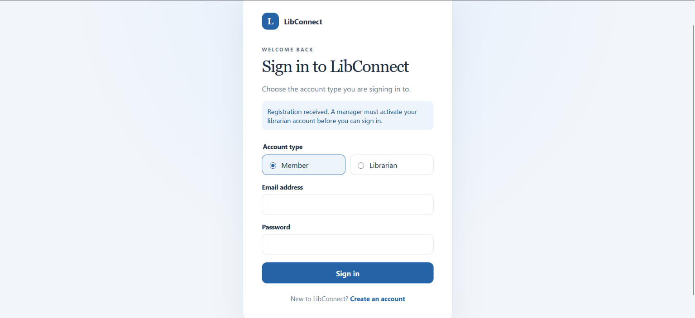

# LibConnect User Guide

## Table of contents

- [Getting to LibConnect](#getting-to-libconnect)
- [Registering a new account](#registering-an-account)
  - [Getting a manager account](#getting-a-manager-account)
- [Logging in](#logging-in)
- Librarian Features
  - [Getting to the librarian dashboard](#getting-to-the-librarian-dashboard)
  - [Catalog and inventory](#catalog-and-inventory)
    - [Find a book](#find-a-book)
    - [Add or edit a book](#add-or-edit-a-book)
    - [Manage physical copies](#manage-physical-copies)
  - [Loans and return/loss reviews](#loans-and-returnloss-reviews)
    - [Create a loan](#create-a-loan)
    - [Review a returned or lost report](#review-a-returned-or-lost-report)
  - [Reservations, fines, and messages](#reservations-fines-and-messages)
    - [Review reservations](#review-reservations)
    - [Review or waive a fine](#review-or-waive-a-fine)
    - [Send a member message](#send-a-member-message)
  - [Member account support](#member-account-support)
  - [Manager-only librarian administration](#manager-only-librarian-administration)
    - [Activate or deactivate a librarian](#activate-or-deactivate-a-librarian)
    - [Reset another librarian's password](#reset-another-librarians-password)
  - [Review assistant](#review-assistant)
    - [Summarize reports](#summarize-reports)
    - [Prepare and send a follow-up draft](#prepare-and-send-a-follow-up-draft)
- Member Features
  - [Member tools](#member-tools)
  - [Browse and search the catalog](#browse-and-search-the-catalog)
  - [Borrow copies of books](#borrow-copies-of-books)
  - [Make or cancel a reservation](#make-or-cancel-a-reservation)
  - [Manage loans](#manage-loans)
  - [View and pay fines](#view-and-pay-fines)
  - [View notifications](#view-notifications)
  - [Update your profile](#update-your-profile)
  - [Ask Libby](#ask-libby)
- [Errors and refreshes](#errors-and-refreshes)
- [Privacy and safe use](#privacy-and-safe-use)

## Getting to Libconnect

Open the [LibConnect sign-in page](https://libconnect-78904.web.app/login) in
your web browser. From this page, you can sign in to an existing account or
select **Create an account** to register.

## Registering an Account

1. On the sign-in page, select **Create an account**.
2. Choose **Member** or **Librarian** as the account type.
3. Enter your full name, email address, password, and password confirmation.

   Librarian registration also requires an employee ID.
4. Use a password with at least eight characters and no whitespace. Make sure

   the confirmation matches the password.
5. Select **Create account**. If a field needs attention or the email or

   employee ID is already in use, the page shows an error so you can correct
    the relevant information.

After a successful registration, LibConnect takes you to the sign-in page.
Member accounts are ready to use. Librarian accounts remain inactive until a
manager activates them; the sign-in page explains this while activation is
pending. Registration does not sign you in automatically.

### Getting a manager account

A manager is a librarian with extra permission to activate, deactivate, and
reset the passwords of other librarian accounts. You cannot register as a
manager, and a manager cannot turn an ordinary librarian into a manager.
Manager status is assigned only by the LibConnect administrator, outside the
website.

To get a manager account, register as a **Librarian** and ask the
administrator to make that account a manager. Without an active manager, newly
registered librarians cannot be activated and cannot sign in.

**Testing LibConnect:** a ready-made manager account (along with librarian and
member test accounts) is listed under
[Test Accounts](./DeveloperGuide.md#test-accounts) in the Developer Guide. Use
it to try the manager tools without waiting for an administrator.

Managers sign in by choosing **Librarian** on the sign-in page. After signing
in, the librarian dashboard shows the extra **Manage librarian accounts** link.
To activate a newly registered librarian, follow
[Activate or deactivate a librarian](#activate-or-deactivate-a-librarian).

## Logging in

1. On the sign-in page, choose **Member** or **Librarian** to match your

   account type.
2. Enter your registered email address and password.
3. Select **Sign in**.

When sign-in succeeds, LibConnect opens the appropriate home page for your
account. If sign-in fails, check that the account type, email, and password are
correct. Librarians must wait for a manager to activate a newly registered
account before signing in. If a librarian account is not active yet, the
sign-in page says so and asks you to contact a library manager (see
[Getting a manager account](#getting-a-manager-account)). Use **Create an account** if you do not have an
account yet.

## Getting to the librarian dashboard

After signing in, open the librarian dashboard. It links to:

- **Catalog & inventory**
- **Loans & reviews**
- **Reservations & fines**
- **Member accounts**
- **Review assistant**
- **Manage librarian accounts** (managers only)

Use **Sign out** when finished. The server, rather than the browser, decides
which tools your account may use.

## Catalog and inventory

Open **Catalog & inventory** to maintain the catalog and physical copies.

### Find a book

Use any combination of title, author, publisher, category, ISBN, or exact
publication year, then select **Search**. Select a book to view its metadata,
availability, and physical copies. The availability panel shows the total number
of copies, available copies, and counts by status.

### Add or edit a book

1. Select **Add a book**.
2. Enter the ISBN, title, author, publication year, publisher, category, and

   optional synopsis.
3. Select **Create book**.

To change a book, select it, choose **Edit book**, update the editable fields,
and choose **Save book**. The ISBN identifies the record and is not changed by
the edit form.

### Manage physical copies

With a book selected:

1. Choose **Add copy** and enter its shelf location.
2. Choose **Edit** beside a copy to change only its shelf location.
3. Choose **Delete** to remove a copy, then confirm the prompt.

Copy status is controlled by lending, return review, reservations, and loss
workflows. Do not interpret the catalog page as a place to manually change a
copy from `ON_LOAN`, `IN_TRANSIT`, `RESERVED`, or `LOST`.

## Loans and return/loss reviews

Open **Loans & reviews**.

### Create a loan

1. In **Create a loan**, enter the member ID and copy ID.
2. Choose **Create loan**.

The member must be active. The copy must be available, or reserved for that
same member and still within its pickup period. A successful loan moves the copy
to **On loan** and assigns a 30-day due date.

### Review a returned or lost report

1. In **Pending reports**, select **Review** for the report.
2. For a returned book, choose an allowed disposition:
   - **Available**: return the copy to the lending pool;
   - **Damaged**: keep it out of circulation; or
   - **Reserved**: assign it to the earliest eligible pending reservation.
3. For a lost book, review the details; the server applies the configured lost-

   book fine and marks the copy lost when confirmed.
4. Choose **Confirm report** or **Reject report**, then confirm the prompt.

Rejecting either report restores the loan to active and the copy to on loan.
Confirming a returned report closes the loan. Confirming a lost report closes
the loan, marks the copy lost, and issues the server-policy fine. A reserved
return creates a pickup expiry and reservation-ready notification.

## Reservations, fines, and messages

Open **Reservations & fines**.

### Review reservations

Filter the reservation queue by ISBN and/or reservation status, then choose
**Apply filters**. The queue shows reservation ID, member ID, ISBN, status, and
pickup expiry. Assignment occurs during an eligible confirmed return review;
the page is for visibility into the queue.

### Review or waive a fine

Filter fines by fine status and optionally member ID. The amount and reason are
server-calculated. For an outstanding fine, choose **Waive** and confirm the
prompt. A successful waiver changes the status to **Waived** and creates a
notification for the member. Paid or already-waived fines cannot be waived
again.

### Send a member message

1. Enter the member ID in **Member ID**.
2. Enter a plain-text message of up to 2,000 characters.
3. Select **Send message** and confirm the prompt.

Messages can be sent only to active members. If a request is retried, the
application's idempotency protection prevents the same confirmed message from
being created twice.

## Member account support

Open **Member accounts** to help with account access.

1. Optionally filter by **Active** or **Inactive** status.
2. Select **View details** to inspect the safe account details.
3. Choose **Activate account** or **Deactivate account**, then confirm.

Activation does not sign the member in automatically. Deactivation preserves
the member's loans, reservations, fines, and notifications, but revokes active
sessions. An inactive member cannot use protected member operations until
reactivated.

## Manager-only librarian administration

Managers can open **Manage librarian accounts**.

### Activate or deactivate a librarian

Choose **Activate account** or **Deactivate account** for the target librarian,
then confirm. A newly registered librarian is inactive until a manager
activates the account. The last active manager cannot be deactivated through
the ordinary page.

### Reset another librarian's password

1. Choose **Reset password** for another librarian.
2. Enter a password of at least eight non-whitespace characters.
3. Enter it again in **Confirm new password**.
4. Tick the confirmation statement and choose **Confirm password reset**.

The old password stops working and the target's sessions are revoked after a
successful reset. A manager cannot use this action to reset their own password;
they must use the account's self-service password flow.

## Review assistant

Open **Review assistant** to work with pending return and loss reports.

### Summarize reports

1. Select one or more pending reports, up to 20.
2. Choose **Summarize selected reports**.
3. Read the generated summary, report facts, suggested review action, and any

   uncertainty.

The summary is advisory. Verify the report in **Loans & reviews** before
confirming or rejecting anything.

### Prepare and send a follow-up draft

1. Choose **Prepare draft** beside a pending report.
2. Read the generated message, rationale, and warning.
3. Edit the message in **Reviewed message** as needed.
4. Choose **Confirm and send reviewed message**, then confirm the prompt.

The draft is not saved as a notification until you explicitly confirm the send.
The assistant cannot confirm a report, change a copy or account status, waive a
fine, choose a recipient, or send a message by itself. Sending still goes
through the normal active-member notification workflow.

## Member tools

Sign in with an active member account to use the member dashboard. The member
navigation provides **Dashboard**, **Borrow**, **Ask Libby**, **Profile**, and
**Logout**. Profile sections include **My Loans**, **My Reservations**, and
**My Fines**. The server checks your account and ownership for protected
actions.

### Browse and search the catalog

Open **Dashboard** to see the catalog and your notification preview. Use the
title search for a case-insensitive title match, then select **Search**. Open
**Advanced Search** to add any combination of author, publisher, category,
ISBN, and publication year filters:

- Title, author, publisher, and category match text without case sensitivity.
- ISBN must match exactly.
- Enter either one exact publication year or both **From year** and **To year**
for an inclusive range. A range needs both years, and the start cannot be
later than the end.
- When Advanced Search is closed, Search uses the title only. When it is open,
the populated criteria are combined, so a result must match every selected
filter.

Select **Clear** to remove the filters. If there are more results, use the
page controls to continue. Select a book to open its details, including its
authors, publication information, synopsis, copy statuses, shelf locations,
and availability. A copy with no shelf location is shown as **Not on shelf**.

### Borrow copies of books

1. On a book's detail page, identify an **Available** copy and note its copy

   ID. Only available copies can be borrowed from the **Borrow** page.
2. Open **Borrow**, enter the copy ID, and select **Add copy**. Repeat for each

   copy you want to borrow. The page shows the selected books and your current
    borrowing capacity; remove a selection if needed.
3. Select **Review and borrow** and check the listed copies in the confirmation

   dialog. Confirm to submit the checkout, or cancel to leave everything
    unchanged.
4. A successful checkout creates the loans and updates the copies together.

   You can see the new loans under **Profile** → **My Loans**.

Members may have up to 10 loans that have not been closed. A pending return or
loss report still counts toward this limit. Checkout is rechecked when
confirmed: every selected copy must still be available, and the complete batch
must fit within your remaining capacity. If any check fails, the batch is not
partially borrowed; review the message, update your selections, and retry.

### Make or cancel a reservation

Open a book's detail page. **Make Reservation** is available when none of the
book's copies is available to borrow (a title with no copies can also be
reserved). Select it to join the queue. If you already have a pending
reservation for that title, the page offers **Cancel Reservation** instead.
The page refreshes its availability and reservation state after an action.

To cancel from the detail page or **Profile** → **My Reservations**, choose
**Cancel Reservation** and confirm in the dialog. You can cancel a pending
reservation while it is waiting or ready for pickup. If a copy was assigned,
cancellation releases it back to availability. Completed, cancelled, and
expired reservations cannot be cancelled.

In **My Reservations**, **Pending** shows current reservations and **History**
shows fulfilled, cancelled, and expired ones. A pending reservation with an
assigned copy shows its pickup expiry date. A reservation expires 15 days
after a copy is assigned; check your notifications for a reservation-ready
message.

### Manage loans

Open **Profile** → **My Loans**. The active view includes active loans and
loans waiting for a librarian to review a return or loss report. Use the past
view for closed loans. Loan cards show the book title and due date; overdue
loans are highlighted. An eligible active loan may also show **Renew**.

To renew an eligible loan, select **Renew** on its card. A loan can be renewed
once, while it is active and before the end of its due date in Singapore. A
successful renewal adds 30 days to its existing due date. The action is hidden
after renewal. A loan that is already renewed, overdue, closed, or awaiting
review cannot be renewed. The server rechecks eligibility when you submit.

To report a return or loss, select **Report Return or Loss** on an active loan,
choose **Returned** or **Lost**, then select **Confirm report**. You can cancel
before confirming without changing the loan. A submitted report appears as
awaiting librarian review and cannot be submitted again while pending. The
report does not itself close the loan or confirm the copy's return or loss;
library staff review it. Any fine for a lost book depends on that review.

### View and pay fines

Open **Profile** → **My Fines**. **Outstanding** is the default view; switch to
**History** for paid and waived fines. Each fine shows the book, reason, issue
date, amount, and status.

For an outstanding fine, select **Pay Fine** and review the amount in the
confirmation dialog. Select **Confirm Payment** to complete the application's
simulated payment. No payment gateway or card details are used. A confirmed
payment moves the fine to **Paid** and it appears in History. Payment cannot
be undone, and a waived fine cannot be paid.

### View notifications

The **Notifications** section on Dashboard shows a preview of recent
notifications, prioritizing unread items. Select a notification to read its
full message and available details. Opening an unread notification marks it
read after the server confirms the update; closing the detail view alone does
not change its read state. Select **View All Notifications** to browse your
notification history. Use **Try again** if a notification list or update
cannot be loaded.

### Update your profile

Open **Profile** to see your account details and profile sections.

- Under **Profile details**, enter a non-empty name and save it.
- Under **Email**, enter a valid address and save it. The address must not
already be used by another member or librarian. The change takes effect
after the server confirms it; email verification is not required.
- Under **Password**, enter your current password, a new password, and its
confirmation. The new password must have at least eight non-whitespace
characters, and both new-password entries must match. Saving keeps your
current session active and signs out your other sessions.

The page shows a success or error message for each update. Password values are
cleared after submission; if an update fails, correct the form and try again.

### Ask Libby

Select **Ask Libby** in the member navigation to ask about LibConnect, the
catalog, borrowing guidance, or your own current loan activity. Enter a
question and select **Send** (or press Enter; Shift+Enter starts a new line).
Libby can explain how to use the app but cannot borrow, reserve, pay, update
your account, or perform other actions for you. Check the relevant page before
acting on its guidance. Libby cannot confirm data when a lookup is unavailable;
it should direct you to the relevant member page instead.

[Back To Top :arrow_heading_up:](#table-of-contents)

## Errors and refreshes

If a page shows an error, read the message, correct the input if needed, and
choose **Refresh** before retrying. A conflict usually means that another
operation changed the record; refresh the queue and review the current state.

The application disables duplicate actions while a request is in progress. A
success message means the server confirmed the operation; a failed request does
not claim that a change was made.

## Privacy and safe use

- Treat member IDs, account details, loan information, and generated text as
private library data.
- Do not put passwords, session information, or unnecessary personal details
into messages or AI prompts.
- Treat AI summaries and drafts as suggestions, not approvals or facts. Check
the underlying record before taking a consequential action.
