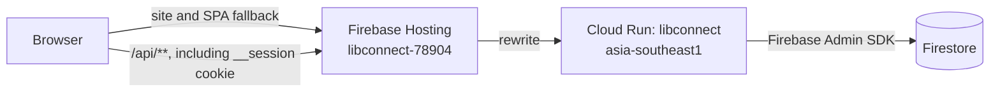

# Production deployment

This document describes the production deployment that is implemented in the repository as of this revision. There is no `specdocs/deployment/` design or task checklist; this reference is grounded in the deployment scripts, container configuration, Firebase Hosting configuration, and API startup code.

## Topology

The browser loads the Vite-built single-page application from Firebase Hosting. Firebase Hosting forwards `/api/**` requests to the Cloud Run service `libconnect` in `asia-southeast1`. The API runs as a Node.js container and uses the Firebase Admin SDK with Application Default Credentials to access Firestore in the configured Firebase project. Authenticated sessions are persisted in the Firestore `sessions` collection.

The session cookie is named `__session` in `apps/api/src/routes/auth.ts`. This replaces the former `libconnect.sid` name: Firebase Hosting forwards the specially named `__session` cookie when proxying requests, while ordinary cookie names such as `libconnect.sid` are not forwarded to the backend. After deploying this change, users with an existing `libconnect.sid` cookie must sign in again to receive a new `__session` cookie. Logout and invalid-session responses clear `__session`.

## Deployment targets and commands

`package.json` provides two independent commands:

| Command | Effect |
| --- | --- |
| `npm run deploy:firebase` | Builds the client with `VITE_API_ORIGIN=https://libconnect-78904.web.app`, then deploys Firebase Hosting only. |
| `npm run deploy:gcloud` | Builds a Linux AMD64 container, pushes it to Artifact Registry, then deploys the image to Cloud Run. |

The Cloud Run deployment script currently uses these constants:

- Google Cloud project: `libconnect-78904`
- Region: `asia-southeast1`
- Cloud Run service: `libconnect`
- Artifact Registry repository: `libconnect`
- Image path: `asia-southeast1-docker.pkg.dev/libconnect-78904/libconnect/junhongkan/libconnect:deploy-1.0`

The Firebase project alias in `.firebaserc` is also `libconnect-78904`. Hosting publishes `apps/client/dist`. The Hosting rewrite in `firebase.json` sends `/api/**` to the `libconnect` Cloud Run service in `asia-southeast1`; all other paths resolve to `/index.html` for client-side routing.

The deployment scripts require the corresponding CLIs and authenticated local accounts: `firebase` for Hosting, and `gcloud` plus Docker Buildx for Cloud Run. The Cloud Run script runs `gcloud auth configure-docker` for `asia-southeast1-docker.pkg.dev` before pushing. The scripts do not provision the Artifact Registry repository, IAM roles, Firestore database, secrets, or Cloud Run environment configuration.

## Container behavior

The root `Dockerfile` uses a two-stage Node 24 slim build. The build stage runs `npm ci`, copies the TypeScript/Vite source, runs `npm run build`, then prunes development dependencies. The runtime stage copies `package.json`, production `node_modules`, `dist`, and `Overview.md`, sets `NODE_ENV=production` and `PORT=8080`, exposes port 8080, and starts `node dist/apps/api/src/server.js`.

The API listens on `process.env.PORT` (defaulting to 3000 for local use). Cloud Run supplies `PORT`; production startup fails if required configuration is missing or invalid.

## Cloud Run configuration

The deployed API requires:

| Variable | Requirement and use |
| --- | --- |
| `FIREBASE_PROJECT_ID` | Required in the deployment setup; selects the Firebase/Firestore project. `GCLOUD_PROJECT` is a code-level fallback. Production Firestore access uses Application Default Credentials from the Cloud Run service identity. |
| `CLIENT_ORIGIN` | Required; must be an HTTP(S) origin without a path. Used by origin protection. For the current Hosting site it is `https://libconnect-78904.web.app`. |
| `SESSION_SECRET` | Required; must contain at least 32 characters. Used by `express-session` to sign session cookies. Keep it in Secret Manager and use the same secret value on every serving revision so existing cookies remain verifiable. |
| `SOCLAAS_BASE_URL` | Secret/configuration used by the server-side SoC LLM adapter. Must be an HTTPS URL without credentials, query, or fragment. |
| `SOCLAAS_API_KEY` | Secret for authenticating to the SoC LLM provider. |
| `SOCLAAS_MODEL` | Configured model name for the SoC LLM provider. |
| `SESSION_MAX_AGE_MS` | Optional session lifetime in milliseconds; defaults to seven days and is capped at 30 days. |

`NODE_ENV=production` and `PORT` are set/supplied by the container and Cloud Run. Do not put provider keys or the session secret in the client build: Vite variables are embedded in downloadable browser assets. Grant the Cloud Run runtime service identity only the required Firestore and Secret Manager access. The deployment script does not select a service identity or configure secret references, so verify those settings on the Cloud Run service separately.

## Release procedure

For a frontend-only change, run `npm run deploy:firebase`. For an API or container change, run `npm run deploy:gcloud`. If a release changes both, deploy the API and Hosting artifacts separately; both scripts target the production project directly.

After an API deployment, the `/health` endpoint reports API status, Firestore connectivity, and the selected project ID. It is implemented in `apps/api/src/server.ts`. The root path is not an API health endpoint; API routes are under `/api/v1`, with health at `/health`.

## Operational boundaries and gaps

- These scripts deploy directly to production; there is no staging target or automated promotion workflow in the repository.
- Cloud Run runtime variables, Secret Manager version references, service account selection, IAM bindings, scaling, and health-check settings are managed outside the deployment scripts.
- The Cloud Run script uses a fixed image tag (`deploy-1.0`), which makes image history less descriptive. The deployed revision still records the image digest, but automated unique tagging is not implemented.
- Firestore rules and indexes are present in `firebase.json`, but `deploy:firebase` explicitly deploys Hosting only. Database rules/index deployment must be performed separately when those files change.
- This document records repository behavior and does not claim that current Google Cloud console settings have been independently inspected.
