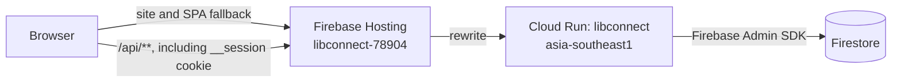

# Production deployment

This document describes the production deployment that is implemented in the repository as of this revision. There is no `workflow/specdocs/deployment/` design or task checklist; this reference is grounded in the deployment scripts, the GitHub Actions deploy workflow, container configuration, Firebase Hosting configuration, and API startup code.

## Topology

The browser loads the Vite-built single-page application from Firebase Hosting. Firebase Hosting forwards `/api/**` requests to the Cloud Run service `libconnect` in `asia-southeast1`. The API runs as a Node.js container and uses the Firebase Admin SDK with Application Default Credentials to access Firestore in the configured Firebase project. Authenticated sessions are persisted in the Firestore `sessions` collection.



The session cookie is named `__session`. It is HTTP-only, uses SameSite
Lax, is secure in production, and is cleared by logout and invalid-session
responses. Hosting and Cloud Run configuration must preserve this cookie on
same-site `/api/**` requests. The API trusts the single Cloud Run proxy hop so
Express recognizes forwarded HTTPS and emits the production Secure cookie.

## Deployment targets and commands

`package.json` provides two independent commands:

| Command | Effect |
| --- | --- |
| `npm run deploy:firebase` | Builds the client with `VITE_API_ORIGIN=https://libconnect-78904.web.app`, then deploys Firebase Hosting only. |
| `npm run deploy:gcloud` | Builds a Linux AMD64 container, pushes it to Artifact Registry, then deploys the image to Cloud Run. |

The Cloud Run deployment script currently uses these constants:

- Google Cloud project: `libconnect-78904`
- Region: `asia-southeast1`
- Cloud Run service: `libconnect`
- Artifact Registry repository: `libconnect`
- Image path: `asia-southeast1-docker.pkg.dev/libconnect-78904/libconnect/junhongkan/libconnect:deploy-1.0`

The Firebase project alias in `.firebaserc` is also `libconnect-78904`. Hosting publishes `apps/client/dist`. The Hosting rewrite in `firebase.json` sends `/api/**` to the `libconnect` Cloud Run service in `asia-southeast1`; all other paths resolve to `/index.html` for client-side routing.

The deployment scripts require the corresponding CLIs and authenticated local accounts: `firebase` for Hosting, and `gcloud` plus Docker Buildx for Cloud Run. The Cloud Run script runs `gcloud auth configure-docker` for `asia-southeast1-docker.pkg.dev` before pushing. The scripts do not provision the Artifact Registry repository, IAM roles, Firestore database, secrets, or Cloud Run environment configuration.

## Container behavior

The root `Dockerfile` uses a two-stage Node 24 slim build. The build stage runs `npm ci`, copies the TypeScript/Vite source, runs `npm run build`, then prunes development dependencies. The runtime stage copies `package.json`, production `node_modules`, `dist`, and `Overview.md`, sets `NODE_ENV=production` and `PORT=8080`, exposes port 8080, and starts `node dist/apps/api/src/server.js`.

The API listens on `process.env.PORT` (defaulting to 3000 for local use). Cloud Run supplies `PORT`; production startup fails if required configuration is missing or invalid.

## Cloud Run configuration

The deployed API requires:

| Variable | Requirement and use |
| --- | --- |
| `FIREBASE_PROJECT_ID` | Required in the deployment setup; selects the Firebase/Firestore project. `GCLOUD_PROJECT` is a code-level fallback. Production Firestore access uses Application Default Credentials from the Cloud Run service identity. |
| `CLIENT_ORIGIN` | Required; must be an HTTP(S) origin without a path. Used by origin protection. For the current Hosting site it is `https://libconnect-78904.web.app`. |
| `SESSION_SECRET` | Required; must contain at least 32 characters. Used by `express-session` to sign session cookies. Keep it in Secret Manager and use the same secret value on every serving revision so existing cookies remain verifiable. |
| `SOCLAAS_BASE_URL` | Secret/configuration used by the server-side SoC LLM adapter. Must be an HTTPS URL without credentials, query, or fragment. |
| `SOCLAAS_API_KEY` | Secret for authenticating to the SoC LLM provider. |
| `SOCLAAS_MODEL` | Configured model name for the SoC LLM provider. |
| `SESSION_MAX_AGE_MS` | Optional session lifetime in milliseconds; defaults to seven days and is capped at 30 days. |
| `LOST_BOOK_FINE_MINOR_UNITS` | Required in production; positive whole number of cents charged when a librarian confirms a lost report. The deployed value is `2000` (SGD 20.00). Without it, confirming a lost report fails with a server error. |
| `OVERDUE_FINE_POLICY_KEY` | Required in production; must be `sgd-fixed-500-after-72h-v1`. |
| `OVERDUE_FINE_MINOR_UNITS` | Required in production; overdue fine in cents. The deployed value is `500` (SGD 5.00). |
| `OVERDUE_FINE_GRACE_HOURS` | Required in production; hours after the due date before an overdue fine is issued. The deployed value is `72`. |

`NODE_ENV=production` and `PORT` are set/supplied by the container and Cloud Run. Do not put provider keys or the session secret in the client build: Vite variables are embedded in downloadable browser assets. Grant the Cloud Run runtime service identity only the required Firestore and Secret Manager access. The deployment script does not select a service identity or configure secret references, so verify those settings on the Cloud Run service separately.

The fine variables are read only when a fine is created, so a missing value does not stop the server from starting. Check them after any change to the service configuration:

```
gcloud run services describe libconnect --region asia-southeast1 --project libconnect-78904 \
  --format="value(spec.template.spec.containers[0].env[].name)"
```

As of 2026-10-23, `SESSION_SECRET` and `SOCLAAS_API_KEY` are set as plain environment variables on the service rather than Secret Manager references. Moving them to Secret Manager (`gcloud run services update ... --update-secrets SESSION_SECRET=<secret>:latest,SOCLAAS_API_KEY=<secret>:latest`) keeps the values out of the service description; reuse the current session secret value so existing sessions stay valid.

## Release procedure

Hosting serves HTML with `Cache-Control: no-cache` and the hashed files under `/assets/` as immutable, so browsers pick up a new release on the next page load instead of requesting a script that no longer exists.

For a frontend-only change, run `npm run deploy:firebase`. For an API or container change, run `npm run deploy:gcloud`. If a release changes both, deploy the API and Hosting artifacts separately; both scripts target the production project directly.

After an API deployment, the `/health` endpoint reports API status, Firestore connectivity, and the selected project ID. It is implemented in `apps/api/src/server.ts`. The root path is not an API health endpoint; API routes are under `/api/v1`, with health at `/health`.

## Continuous deployment (GitHub Actions)

The same two scripts also run in a team-owned GitHub Actions workflow, `.github/workflows/deploy.yml`, so deployment is automated without any AI-vendor build-and-host environment. The workflow checks out `main`, installs dependencies and the Firebase CLI, authenticates to Google Cloud, then runs `npm run deploy:gcloud` and/or `npm run deploy:firebase`. It is triggered manually from the Actions tab (`workflow_dispatch`) with a `target` input of `both`, `api`, or `hosting`; an optional push-to-`main` trigger is included but commented out.

Authentication uses a single repository secret, `GCP_SA_KEY`, containing a JSON key for the `github-actions-deployer@libconnect-78904.iam.gserviceaccount.com` service account. That account holds the roles the two scripts require:

| Role | Needed for |
| --- | --- |
| Cloud Run Admin (`roles/run.admin`) | Deploy the Cloud Run service |
| Artifact Registry Writer (`roles/artifactregistry.writer`) | Push the container image |
| Service Account User (`roles/iam.serviceAccountUser`) | Act as the Cloud Run runtime service account |
| Firebase Hosting Admin (`roles/firebasehosting.admin`) | Deploy Firebase Hosting |
| Service Usage Consumer (`roles/serviceusage.serviceUsageConsumer`) | Let the Firebase CLI check enabled APIs |

Like the manual scripts, the workflow does not set Cloud Run runtime variables or secrets; `gcloud run deploy --image` preserves the service's existing configuration. The GitHub `production` environment can be given required reviewers to keep a human approval gate on releases. A full run was verified on 2026-10-23, deploying both the API (Cloud Run revision `libconnect-00033-q5b`) and Firebase Hosting.

## Operational boundaries and gaps

- Deployment is automated through the `.github/workflows/deploy.yml` GitHub Actions workflow, and the same scripts can also be run manually. Both paths deploy directly to production; there is no staging target or promotion gate beyond the optional required reviewers on the `production` GitHub environment.
- Cloud Run runtime variables, Secret Manager version references, service account selection, IAM bindings, scaling, and health-check settings are managed outside the deployment scripts.
- The Cloud Run script uses a fixed image tag (`deploy-1.0`), which makes image history less descriptive. The deployed revision still records the image digest, but automated unique tagging is not implemented.
- Firestore rules and indexes are present in `firebase.json`, but `deploy:firebase` explicitly deploys Hosting only. Database rules/index deployment must be performed separately when those files change.
- This document records repository behavior and does not claim that current Google Cloud console settings have been independently inspected.
