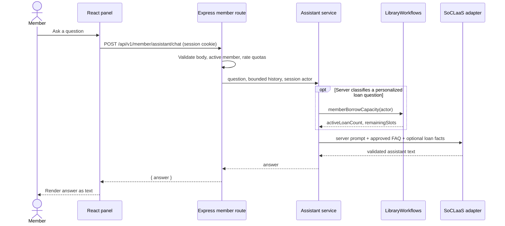

# Member AI Assistant (Libby)

Libby is a read-only assistant available to signed-in members from the shared member navigation. It answers LibConnect navigation and workflow questions and a small set of personalized active-loan questions. It cannot borrow or reserve books, cancel reservations, pay fines, or modify library/account records.

## Request flow



The route is implemented by `createMemberAssistantRouter` in `apps/api/src/routes/member-assistant.ts` and mounted at `/api/v1/member` in `apps/api/src/server.ts`. It applies the existing session-backed `requireActiveActor` middleware and then requires an active `MEMBER` actor with a member ID. The member identity is always `request.actor`; the body schema is strict and does not accept an identity, role, prompt instruction, or model field.

The client uses `assistantApi.chat` in `apps/client/src/api/assistant.ts`, which calls `apiRequest` and therefore sends the session cookie. The `MemberAssistantProvider` in `apps/client/src/components/MemberAssistant.tsx` lives above the application routes so chat state survives page navigation. `MemberNavigation` supplies the launcher across member pages. The provider holds at most 20 messages in memory, sends at most 10 prior turns, and clears the conversation when the authenticated member changes or logs out. It does not persist history. Answer and error content are rendered as ordinary React text.

## Server behavior

`apps/api/src/assistant/faq.ts` contains approved page destinations and workflow guidance, plus conservative server-side rules that classify loan-count, remaining-capacity, and borrowing-block questions. Only those recognized intents call `LibraryWorkflows.memberBorrowCapacity(actor)` from `apps/api/src/storage/workflows.ts`. That workflow counts `ACTIVE` loans for the actor's member ID and returns `max(0, 10 - activeLoanCount)` remaining slots. Other FAQ and ambiguous questions do not load or send member loan facts.

`apps/api/src/assistant/service.ts` bounds the question and history, labels message/history content as untrusted, builds the server-owned model context, and rejects empty or oversized model answers. If a required loan lookup fails or returns inconsistent facts, it throws a typed data-unavailable error; the API maps this to HTTP 503 `AI_MEMBER_DATA_UNAVAILABLE` with a safe My Loans or Borrow destination. Provider/configuration and malformed-answer failures map to a generic HTTP 503 `AI_UNAVAILABLE`; quota violations use HTTP 429 `AI_RATE_LIMITED`. Errors do not include provider bodies, credentials, or storage details.

No model tools are sent or exposed. The model cannot select a member, query records, or authorize an action. The assistant has no write path. Application text and conversation content remain untrusted prompt data; prompt instructions do not replace route authentication or server authorization.

## SoCLaaS and quotas

`apps/api/src/integrations/soclaas/client.ts` reads `SOCLAAS_BASE_URL`, `SOCLAAS_API_KEY`, and `SOCLAAS_MODEL` on the server. It requires an HTTPS base URL and sends the configured model to `/chat/completions` with Bearer authentication. It validates the response shape and maps errors to fixed safe messages. Configuration is resolved lazily, so missing AI configuration disables assistant requests without preventing the API from starting. One transient retry may occur within the shared 15-second request deadline.

`apps/api/src/assistant/rate-limiter.ts` uses synchronous in-memory fixed windows: 5 requests per member per minute and 60 per process per minute. Expired member entries are pruned, and the member map is bounded to 10,000 entries by default; a full map denies new member reservations until entries expire. Counters reset on restart and do not coordinate across processes. This matches the approved one-production-process assumption; revisit the limiter before scaling to multiple processes or requiring continuity through restarts.

## Verification

Run:

```text
npm run build
npm test
```

The standard test command includes five assistant suites:

- `tests/member-api/member-ai-soclaas-client.test.mjs` — configured request, malformed response, safe errors, retries, deadline, fake transport.
- `tests/member-api/member-ai-rate-limiter.test.mjs` — per-member/global thresholds, concurrent reservations, expiry and bounded state.
- `tests/member-api/member-ai-assistant-service.test.mjs` — FAQ guidance, personalized facts and loan-count boundaries, data failures, untrusted input.
- `tests/member-api/member-ai-assistant-api.test.mjs` — session authorization, strict validation, error mapping, ownership and quota behavior.
- `tests/client/client-member-assistant.test.mjs` — authenticated API call, route persistence, logout/account change, safe text/error rendering.

The implementation was verified with `npm run build`, all five focused suites (33 tests), and `npm test` (284 tests). Builds emit the repository's existing Vite chunk-size advisory; the Playwright test emits a Node `punycode` deprecation notice.

## Current limits

The service validates model response structure and length but does not independently prove the semantic truth of arbitrary model-generated FAQ wording. Personalized facts are deterministic server inputs, but their wording in the final answer still depends on the model. The in-memory quota counters assume one server process and reset at restart. The assistant does not have a live catalog search or availability lookup; it directs members to the existing catalog and book detail pages.
