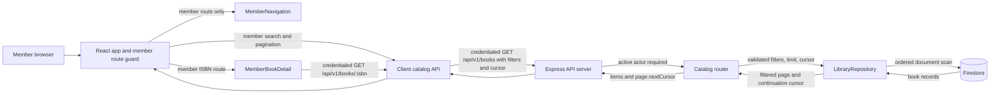

# Member Dashboard Feature Details

## Implementation status

The member dashboard implementation is integrated: the catalog API supports the publication-year range contract, and the client provides member navigation, greeting/search controls, catalog cards, cursor-based result states, and a member book-detail route/page. Search always applies the title criterion; populated advanced criteria are included only when Advanced Search is expanded at submission time. Following the approved 2026-10-23 amendment, member book cards show the title, category, and shortened synopsis without a cover image or placeholder. The card-rendering task and integrated-verification task are complete; the full suite passed 453/453. A live browser walkthrough was not possible because no browser surface or DOM test harness was available.

In `workflow/specdocs/completed/member-dashboard/tasks.md`, all eight tasks are checked, including the amended catalog card/result-state task and integrated verification task.

## Current architecture

The feature spans the React member routes and catalog UI, credentialed client API, authenticated Express catalog routes, and Firestore repository:



The API is mounted under `/api/v1` in `apps/api/src/server.ts`. The server applies active-actor authentication to business routes, and `createCatalogRouter` also protects the book-list route with `requireActiveActor`. The API remains the only application layer that reads Firestore.

Relevant implementation modules:

- `apps/client/src/App.tsx` keeps the librarian welcome view and renders `MemberNavigation` for the authenticated member dashboard branch.
- `apps/client/src/components/MemberNavigation.tsx` renders the dashboard brand link, disabled current Dashboard item, disabled Profile button, and red Logout button. The Logout button uses the shared destructive-action style; its callback is supplied from `useAuth().logout`.
- `apps/client/src/pages/MemberDashboard.tsx` renders the signed-in member greeting, title search, expandable advanced search controls, year validation, and submit/clear actions. It combines trimmed text criteria and sends selected exact year or complete range criteria together through `catalogApi.listBooks`. Submit and clear request a fresh first page; a request sequence prevents stale responses from replacing the current result state. Search errors and range validation errors are announced to assistive technology.
- The same page loads the first catalog page on member-dashboard mount and renders cards with the title, category, line-clamped synopsis, and an ISBN link to `/member/books/:isbn`; it has no cover image or placeholder. It does not filter by copy availability. “Load more books” sends the current submitted filters, the server-returned `nextCursor`, and prior page limit; results append with ISBN deduplication against the latest state. Initial loading and failure/retry, incremental loading and failure/retry, no matches, and end-of-results are represented separately. The member detail route is registered for these links.
- `apps/client/src/pages/MemberBookDetail.tsx` reads the ISBN route parameter and loads `catalogApi.getBook(isbn)`. It renders book metadata, synopsis, copy shelf locations and statuses, and the server availability summary. It distinguishes loading, HTTP 404 not-found, and retryable request failures. A request sequence prevents stale responses when the ISBN changes or the page unmounts.
- `apps/client/src/App.tsx` protects `/member/books/:isbn` with `ProtectedRoute accountType="MEMBER"`; the existing librarian route and dashboard remain separate.
- `apps/client/src/styles.css` styles the current navigation state, disabled profile control, keyboard focus outlines, and narrow-screen layout.
- `apps/api/src/server.ts` mounts the catalog router and active-actor middleware.
- `apps/client/src/api/catalog.ts` defines `BookFilters`, serializes list filters into query parameters, validates paired range bounds and exact/range mutual exclusion, and delegates requests to `apiRequest`.
- `catalogApi.getBook` URL-encodes the ISBN path segment and uses the existing credentialed `apiRequest`; the API returns `{ book, copies, availability }`.
- `apps/api/src/routes/catalog.ts` validates book-list query parameters, parses cursors, calls the repository, and returns the existing paginated response shape.
- `apps/api/src/storage/repositories.ts` applies Firestore exact filters and scans candidate books for range and substring matches.
- `apps/api/src/http/errors.ts` maps query-schema errors to HTTP 400 `VALIDATION_ERROR` responses and invalid repository cursors to HTTP 400 `INVALID` responses, both using the `{ error: { code, message, ... } }` envelope.

## Book-list query contract currently implemented

`GET /api/v1/books` accepts the existing title, author, publisher, category, exact ISBN, exact publication year, limit, and cursor filters. It now also accepts:

| Parameter | Behavior |
| --- | --- |
| `publicationYear` | Existing exact integer match, from 0 through 9999. |
| `publicationYearFrom` | Inclusive integer lower bound, from 0 through 9999. Must be supplied with `publicationYearTo`. |
| `publicationYearTo` | Inclusive integer upper bound, from 0 through 9999. Must be supplied with `publicationYearFrom`. |

Range bounds must contain digits only. Empty, whitespace-only, decimal, non-numeric, and out-of-domain bounds are rejected. The lower bound must be no greater than the upper bound. Exact year cannot be combined with either range parameter. Invalid query combinations return HTTP 400 with the existing validation error envelope.

All provided filters combine with AND semantics. A range is checked before the selected text substring filters. ISBN and exact publication year are applied as Firestore equality filters; range bounds are applied during the repository scan. Text filters are case-insensitive substrings over title, publisher, category, and author. Author may be stored as a string or an array. Synopsis is returned as part of book records but is not searched.

The response remains:

```json
{
  "items": [],
  "page": {
    "limit": 20,
    "nextCursor": null
  }
}
```

The client `BookFilters` type exposes exact year or the two range bounds. `catalogApi.listBooks` rejects a partial range and rejects exact year combined with a range before sending a request. Valid filters continue through the existing URL parameter serializer and `apiRequest`, which includes credentials; the `Page<T>` response and next cursor shape are unchanged.

The page size remains bounded to 1–50, defaulting to 20. No response fields or book/copy domain records changed for these increments.

## Member book detail route

`/member/books/:isbn` is available only through the member-specific protected route. The page fetches the ISBN through the shared credentialed client and uses the API's complete detail response. Author strings and arrays are both rendered; a missing synopsis receives a short fallback message. Copy statuses are displayed as readable text, and the API availability counts show available and total copies. No client-side database access or separate copy query is used.

The test `tests/client/client-member-detail.test.mjs` verifies the member route declaration, required fields and states, encoded ISBN request path, and credential inclusion (4/4 passed). The final `npm test` passed 453/453, including the build; the focused member client tests passed 39/39. The authenticated catalog range Firestore Emulator verification passed during the API implementation task; it was not rerun during final integration verification because the API behavior was unchanged. Tests assert source contracts, SSR markup, and API request behavior; the project has no DOM test harness, so actual browser interactions and page state transitions are not exercised directly. A live browser walkthrough was unavailable. The local Firestore Emulator, API health check, and client HTTP response were verified before those temporary services were stopped.

## Search and pagination flow

```mermaid
sequenceDiagram
    participant Client
    participant API as Express catalog route
    participant Repo as LibraryRepository
    participant DB as Firestore

    Client->>API: GET /api/v1/books?publicationYearFrom=2000&publicationYearTo=2002&title=...
    API->>API: Require active actor; validate paired, ordered bounds
    API->>Repo: searchBooks(filters, limit, cursor)
    Repo->>Repo: Bind cursor to normalized filter set
    Repo->>DB: Apply ISBN/exact-year equality filters; order by document ID
    loop Scan batches of up to 100 records
        DB-->>Repo: Candidate books
        Repo->>Repo: Apply inclusive range, then case-insensitive text filters
    end
    Repo-->>API: Matching items and cursor at last scanned document
    API-->>Client: { items, page: { limit, nextCursor } }
```

The repository scans in batches of up to 100 documents ordered by document ID and returns at most the requested number of matches. The continuation cursor contains the last scanned document ID and a key derived from the normalized search filters. Because the range endpoints are part of that filter set, a cursor cannot continue a search after the year range or another filter changes. The limit and cursor themselves are removed before filter identity is calculated.

## Verification

The increment adds:

- `tests/catalog-year-range.test.mjs`, a focused route-level test for exact-year compatibility, accepted range serialization, and 400 responses for missing, reversed, malformed, blank, whitespace-only, and exact-plus-range filters.
- `tests/client-catalog-api.test.mjs`, a focused client test for range serialization with combined filters and pagination, exact-year compatibility, credential inclusion, response preservation, and invalid range rejection before a request.
- `tests/client/client-member-navigation.test.mjs`, a server-rendered client test for member-only navigation, destinations, current/disabled state, Profile/Logout ordering, keyboard-capable native controls, and librarian view preservation.
- `tests/verify-catalog-year-range-emulator.mjs`, an authenticated emulator-backed integration check covering exact-year regression, inclusive lower and upper boundaries, AND combinations across text fields and ISBN, invalid range cases, filter-bound cursors, and duplicate-free pagination.
- `npm test` includes the focused API, client serialization, navigation, search, result-state, and detail tests; `npm run verify:catalog-year-range:emulator` builds and runs the authenticated emulator verification.

Across these increments, the route tests passed (3/3), client API tests passed (4/4), navigation/auth tests passed (9/9), and the authenticated Firestore Emulator range verification passed. Final integrated checks passed: `npm test` 453/453, `npm run lint`, and `npm run format:check`. Build output includes a Vite advisory that the client bundle exceeds 500 kB. Node also emitted a `punycode` deprecation warning; a validation-path test printed an error diagnostic while passing. The emulator and API processes used for earlier verification were stopped afterward.

## Search controls currently implemented

The member dashboard has a basic title substring field and expandable advanced fields for author, publisher, category, ISBN, exact publication year, and publication-year range. Text values are trimmed before being passed to the client catalog API. Multiple supplied criteria are combined in one `BookFilters` object and use the API's existing AND semantics. ISBN remains an exact filter; the text fields use the API's case-insensitive substring behavior.

At each submission, `MemberDashboard` reads the current `open` property of its Advanced Search `<details>` element through `advancedSearchRef`. If collapsed, `buildMemberBookFilters` returns the title filter only before parsing or validating advanced values, so retained hidden values do not affect the request or block title search. If expanded, populated advanced criteria are included with the title and year validation runs normally. Reopening the panel makes its retained values eligible for a later submission.

Year values are parsed as safe integers from 0 through 9999. Exact year cannot be mixed with a range; a range requires both bounds and the start year cannot exceed the end year. Invalid values display an inline alert and prevent the request. The UI disables the exact-year field while either range bound is populated and disables the range fieldset while exact year is populated. Search and Clear filters reset the in-memory result page and issue a cursorless request through `catalogApi.listBooks`; clearing submits an empty filter object. No client code reads Firestore directly.

The focused search test `tests/client/client-member-search.test.mjs` passes 7/7. It verifies rendered controls, filter construction and year validation, submit/clear first-page behavior, and the expanded-then-collapsed retained-values scenario. The collapse regression checks that the submit handler reads the live `<details>.open` value and checks the expanded and collapsed filter results for the same values. This combines source-wiring and filter-builder checks; it does not dispatch real browser events. The librarian branch remains unchanged.

For the amended card requirement and cursor-based result states, `tests/client/client-member-dashboard-results.test.mjs` passed 4/4, and `npm run build` passed. The test asserts the required card text and absence of the cover placeholder/image markers. Independent review passed the implementation and integrated verification. These tests inspect source text rather than exercising a DOM, so request sequencing, retries, deduplication, keyboard activation, and visual layout lack direct browser runtime coverage. The member detail route is registered for card links.

## Verification limitations

- No live browser walkthrough was completed. The collapse regression checks the live disclosure-state wiring and expanded/collapsed filter construction, but does not dispatch actual form or disclosure events or inspect resulting network requests. Pagination clicks, logout, and rendered loading/error transitions are also verified by source/SSR-focused tests rather than browser interaction.
- Firestore Emulator-backed range verification was previously run and passed; it was not repeated during the final integration task. The API and client were started with the local emulator for a walkthrough attempt, but no test data or account was created because no browser surface was available.
