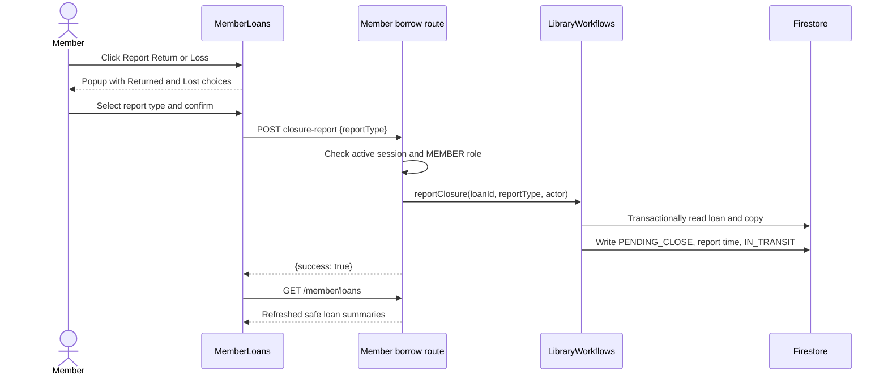

# Member loans

## Purpose and current behavior

The member My Loans page lists the signed-in member's loans, separates active and pending-review loans from closed loans, and lets the member report an active loan as returned or lost for librarian review. A member report is not a completed return or loss: librarian review remains responsible for closing the loan and choosing the copy's final state.

The loan summary exposes only `loanId`, `bookTitle`, `dueDate`, `status`, `returnDateTime`, `closureReportType`, and `isRenewed`. The storage query filters by the authenticated actor's `memberId`, sorts by descending `borrowDateTime`, and parses every record with `LoanRecordSchema` before creating the summary.

The active page view includes `ACTIVE` and `PENDING_CLOSE`; the past view includes `CLOSED_RETURNED` and `CLOSED_LOST`. Active loans are highlighted as overdue only after their due date has ended in `Asia/Singapore`. Pending cards state whether the submitted report was for a return or loss and that librarian review is pending. Only active cards offer **Report Return or Loss**.

## Request and state flow

`POST /api/v1/member/loans/:loanId/closure-report` accepts a strict JSON object with `reportType` set to `RETURNED` or `LOST`. The route is mounted by `apps/api/src/server.ts` under `/api/v1/member` and runs through the existing active-actor and member-role checks. It derives the member from `request.actor`; the request body cannot supply an identity. Invalid bodies use the standard validation envelope. Successful submission returns `{ "success": true }`; ownership and stale-state errors use the standard 403 and 409 error envelopes.

The route delegates to `LibraryWorkflows.reportClosure` in `apps/api/src/storage/workflows.ts`. That workflow validates the active member, report type, loan ownership, `ACTIVE` loan status, and `ON_LOAN` copy status. One Firestore transaction records `closureReportType`, changes the loan to `PENDING_CLOSE`, records a Firestore timestamp, and changes the linked copy to `IN_TRANSIT`. It does not set `returnDateTime`, issue a fine or notification, or perform librarian review.

The page uses a modal popup over a fixed, dimmed backdrop. Its centered, scrollable panel first offers **Returned** and **Lost**, then advances to a confirmation step in the same popup. **Lost** uses the red destructive-action style. The popup provides cancel/back actions, Escape handling, focus placement, and a button focus loop. Submission is guarded while in flight. On success, the page refreshes the loan list; if that refresh fails, it updates that loan to pending review locally based on the accepted server response. A 409 triggers a best-effort refresh and explains that the loan is no longer active. Other failures keep the last server-confirmed loan state and show the error.

## Main code paths

- `apps/api/src/storage/workflows.ts` — `LibraryWorkflows.memberLoans` and `reportClosure` implement the safe member summary and transactional report transition.
- `apps/api/src/routes/member-borrow.ts` — member authorization, strict request schema, and closure-report route.
- `apps/api/src/http/auth.ts` and `apps/api/src/http/errors.ts` — active session actor and standard error handling.
- `apps/client/src/api/borrow.ts` — `MemberLoan` summary type, safe decoding, list call, and `reportClosure` client call.
- `apps/client/src/pages/member-loan-view.ts` — active/past filters and Singapore due-day overdue rule.
- `apps/client/src/components/MemberLoanCard.tsx` — loan status presentation and report action.
- `apps/client/src/pages/MemberLoans.tsx` — list loading, report popup steps, submission lifecycle, refresh, and feedback.
- `apps/client/src/styles.css` — fixed popup backdrop, centered panel, responsive sizing, and report controls.
- `tests/member-loans-api.test.mjs`, `tests/member-borrow-storage.test.mjs`, and `tests/client-member-loans.test.mjs` — API, storage, and client coverage.
- `tests/verify-member-loan-closure-emulator.mjs` — real Firestore Emulator concurrency and atomic state verification.

## Verification

The member report API, storage transition, Firestore transaction, view filtering, due-date boundary, summary decoding, report request, and browser interactions have automated coverage. `tests/client-member-loans-browser.test.mjs` launches the built client in Chromium and exercises both popup steps, cancellation without a request, keyboard focus trapping and restoration, one submission while the request is pending, successful refresh to pending review, and stale-state refresh/error handling.

`npm test` passed all 234 tests, including the Chromium browser suite, after the popup styling correction. `npm run verify:member-loans:emulator` also passed after that correction, confirming that concurrent reports allow one transition, loan and copy receive the same transition timestamp, and `returnDateTime` is preserved. Playwright 1.63.0 is pinned as a development dependency; install the matching Chromium browser with Playwright's install command when preparing a fresh environment.
