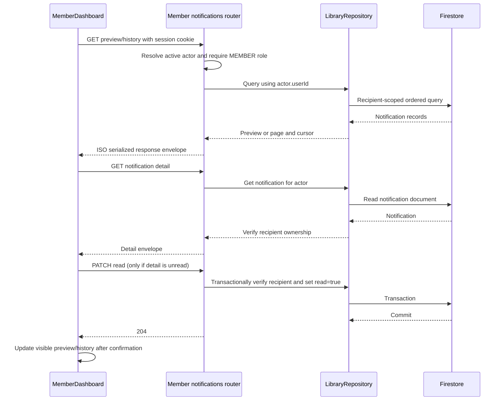

# Member notifications

## Purpose and current behavior

The member dashboard displays notifications addressed to the signed-in member. Members can inspect a newest-first preview, browse the complete history in a scrollable dialog, and open a detail dialog. Opening an unread notification requests a read update; the UI changes its read styling only after the server confirms. Members cannot create, edit, or delete notification records through this feature.

Implemented behavior covers the first six tasks in `specdocs/member-notifications/tasks.md`. The final integration task remains unchecked because the full `npm test` command currently has two failures in member-loan and My Fines tests from concurrent workspace changes. Notification tests, build, and the dedicated emulator check passed in the latest reported run.

## Architecture and request flow

### Storage

`apps/api/src/storage/repositories.ts` implements the member queries on `LibraryRepository`:

- `notificationPreview(actor)` requires an active member. It queries all unread notifications for `actor.userId`; when there are fewer than two, it separately queries up to one or two newest read notifications. A merge sorts by timestamp and document ID descending.
- `notificationHistory(actor, limit, cursor)` requires an active member, validates a 1–100 page bound and actor-bound cursor, orders by `createdAt` descending and document ID descending, and requests one extra record to determine whether another page exists. Cursor timestamps preserve Firestore seconds and nanoseconds.
- Existing `getNotification` and `markNotificationRead` methods enforce recipient ownership. The read update uses a Firestore transaction.

The required composite indexes are in `firestore.indexes.json`: recipient/read/createdAt/document ID for filtered preview queries, and recipient/createdAt/document ID for full history.

### API

`apps/api/src/routes/member-notifications.ts` is mounted from `apps/api/src/server.ts` at `/api/v1/member/notifications`. Each endpoint resolves an active session actor and applies a member-role check. Recipient IDs are taken from the actor, never from request parameters.

| Request | Response and behavior |
|---|---|
| `GET /preview` | `{ items }`, with Firestore timestamps serialized as ISO strings. |
| `GET ?limit=…&cursor=…` | `{ items, page: { limit, nextCursor } }`; limit defaults to 20 and is bounded to 1–100. Cursor is base64url encoded, validated, and bound to the actor. Unknown query fields are rejected. |
| `GET /:notificationId` | `{ notification }` only when the notification belongs to the member. |
| `PATCH /:notificationId/read` | Verifies ownership, skips a write for an already-read notification, and returns `204`. |

The router uses the shared API error envelope. Signed-out, inactive, wrong-role, malformed-cursor, and foreign-recipient access paths are covered by tests.

### Client API and dashboard

`apps/client/src/api/notifications.ts` defines the client `NotificationRecord`, notification type/reference unions, response envelopes, and `notificationsApi` methods for preview, history, detail, and mark-read. All requests use `apiRequest` and its cookie credentials, 204 handling, and `ApiClientError` behavior. Timestamps are typed as ISO strings; reference fields are nullable.

`apps/client/src/pages/MemberDashboard.tsx` renders the preview between the greeting and catalog search. It preserves server ordering and selection, labels each card's type/read state, truncates message previews, and keeps notification loading and error state separate from catalog state. Messages use normal React text rendering.

The dashboard also owns history and detail dialogs. History requests pages of 20 using the returned cursor, appends and deduplicates records, and prevents concurrent page requests while scrolling. Detail content shows the full message, type, localized creation time, and reference fields as plain text. An unread item is marked read only after detail retrieval and server update; confirmed state is synchronized across visible preview and history items. Failed updates stay unread and expose a retry. Dialogs support Escape, Tab focus containment, labels, and focus restoration.

## Verification

- `npm run build` passed during the latest integration run; Vite emitted a large-chunk advisory.
- Focused notification API/storage/client checks passed in the latest integration run.
- `npm run verify:member-notifications:emulator` passed against the configured local Firestore emulator. The verifier refuses production, non-local emulator hosts, and non-`demo-*` project IDs; it exercises preview selection, scoped history ordering, bounded cursor pages, and recipient isolation, then deletes its random fixtures.
- `npm test` failed with two failures in unrelated member-loan and My Fines tests (`tests/client-member-loans.test.mjs:85` and `tests/client-member-navigation.test.mjs:124`). All notification tests passed in the reported run. The final integration task remains open until the full suite passes.

Focused client dashboard tests currently inspect source contracts rather than mounting React components; runtime interaction behavior is therefore not independently exercised by those tests.

## Notification creation ownership

This feature does not change notification creation. Reservation fulfillment continues to create `RESERVATION_READY` notifications in `apps/api/src/storage/workflows.ts`, within the librarian circulation workflow.
