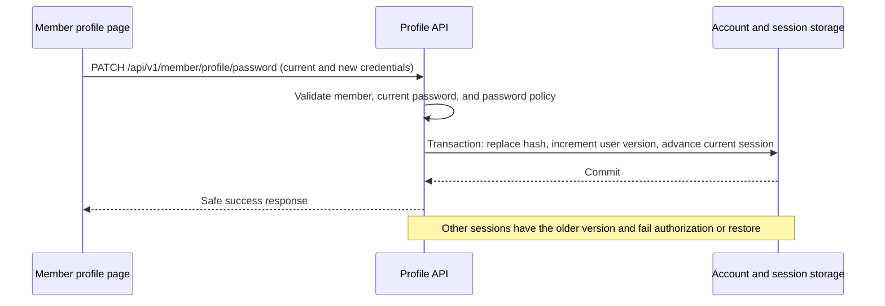

# Member Profile

## Purpose and scope

The member profile hub lets an authenticated active member update their own name, email, and password, view their loans, and open My Reservations and My Fines placeholders. The client never selects an account by ID; APIs derive the actor from the signed-in server session. Librarian and manager profile operations, email verification, and password recovery are outside this feature. Reservation and fine workflows are not implemented.

## Entry points and components

- `apps/client/src/App.tsx` mounts member-only routes for `/member/profile`, `/member/profile/loans`, `/member/profile/reservations`, and `/member/profile/fines`.
- `apps/client/src/components/MemberNavigation.tsx` provides the member navigation link and identifies it as current on the profile route.
- `apps/client/src/pages/MemberProfile.tsx` loads the safe profile and renders the name, email, and password forms together on one page. It validates form input, displays status/error feedback inside the section for the relevant operation, and updates authenticated client state after name/email changes.
- `apps/client/src/components/MemberProfileHub.tsx` renders the Profile, My Loans, My Reservations, and My Fines navigation and marks the current destination. Its reservation/fine placeholder renders unavailable messaging without requesting records or presenting controls.
- `apps/client/src/pages/MemberLoans.tsx` loads the authenticated member's loans and presents Active and Past views, with loading, error, and empty states. `apps/client/src/pages/member-loan-view.ts` separates `ACTIVE` loans from non-active loans, formats due dates, and identifies overdue active loans. `apps/client/src/components/MemberLoanCard.tsx` renders each loan title and due date, highlights overdue active loans in red, and shows a disabled Return button only on active loans.
- `apps/client/src/api/borrow.ts` exposes `borrowApi.listLoans()` through the cookie-authenticated API client and normalizes ISO and Firestore timestamp JSON due dates.
- `apps/client/src/api/member-profile.ts` calls the profile API through `apiRequest`, which includes the cookie session.
- `apps/client/src/auth/AuthContext.tsx` exposes `updateUser` to update the safe in-memory account summary for the current user.
- `apps/api/src/routes/member-profile.ts` implements the profile endpoints and member-only authorization.
- `apps/api/src/storage/accounts.ts` performs account reads and updates; `apps/api/src/storage/repositories.ts` provides transactional identity-key updates.
- `apps/api/src/http/auth.ts`, `apps/api/src/routes/auth.ts`, and `apps/api/src/storage/firestore-session-store.ts` enforce and persist authentication versions.

The hub's Profile destination contains separate, headed sections for name, email, and password updates; all three forms are visible together. The hub navigation sits beside the content on wide screens and above it on narrow screens. My Loans shows Active by default; Past includes every non-`ACTIVE` status, including pending closure and closed loans. Reservations and Fines remain placeholders. The earlier three-form tab navigation was superseded by the single Profile subpage, then the hub destinations were added around it.

## API behavior

Profile routes are under `/api/v1/member/profile`; the loan-list route is `/api/v1/member/loans`. All use the authenticated session:

| Method and path | Behavior |
| --- | --- |
| `GET /api/v1/member/profile` | Returns `{ user }`, the current member's safe account summary. |
| `PATCH /api/v1/member/profile/name` | Accepts `{ "name": string }`; trims and validates a non-empty name up to 120 characters. Returns `{ user }`. |
| `PATCH /api/v1/member/profile/email` | Accepts `{ "email": string }`; validates the address and updates it immediately after uniqueness is secured. Returns `{ user }`. |
| `PATCH /api/v1/member/profile/password` | Accepts `currentPassword`, `newPassword`, and `confirmPassword`; verifies and replaces the password. Returns `{ user }` without credential data. |
| `GET /api/v1/member/loans` | Returns `{ loans }`, an allowlisted list of the authenticated member's loan records. |

The safe `user` object contains `userId`, `name`, `email`, `accountType`, `accountStatus`, and `memberId` when present. It excludes password hashes and authentication-version fields. Each loan contains `loanId`, `bookTitle`, `dueDate`, `status`, and `returnDateTime` from storage; the client maps the fields it displays (`loanId`, `bookTitle`, `dueDate`, `status`) and normalizes Firestore timestamp JSON for `dueDate`.

Request schemas reject unknown fields, including client-supplied account identifiers or authentication versions. The route requires an active `MEMBER`; signed-out and librarian requests are rejected. Responses use the established API error envelope. Safe summaries are explicitly constructed and omit password hashes, authentication versions, and other server-only fields.

Email values are trimmed for storage and compared through the shared canonical email key. The repository transaction claims the new key and releases the old key together with the email change, preserving uniqueness across member and librarian identities. A conflict leaves the account unchanged. This also permits registration of the released old address.

The browser performs early email/password/confirmation checks. The server repeats authoritative checks. Names and emails remain in the form when an operation fails; password fields are cleared after the password request completes. Each operation's success or API error appears as an accessible status/alert inside that operation's section (name, email, or password), rather than in a shared message at the top of the page. A profile-load error is shown in the Profile details section. After a successful name or email update, `updateUser` synchronizes the current member summary without signing out.

## Password changes and session lifecycle

The new password must contain at least eight Unicode code points and no whitespace. The server verifies the current password and uses Argon2id for the replacement hash. It then performs one Firestore transaction that updates the password hash, increments the user's `authVersion`, and advances the session used for the change to that version.

Other sessions retain their earlier version. `requireActiveActor` rejects them when their version differs from the current user record. `GET /api/v1/auth/session` also destroys a stale session and clears its cookie. Login writes the current version into the new session. For backward compatibility, missing user or session versions are interpreted as `0`; versionless sessions work only while the account version remains `0`.

## My Loans data flow

`GET /api/v1/member/loans` runs behind the active-actor and member-role checks. `LibraryWorkflows.memberLoans(actor)` queries only records whose `memberId` matches the authenticated actor, validates each record with `LoanRecordSchema`, and returns only `loanId`, `bookTitle`, `dueDate`, `status`, and `returnDateTime`. It does not read or mutate copy state or return reservation/fine data. The client normalizes Firestore timestamp JSON to an ISO string before rendering.

The My Loans page separates records with `status === "ACTIVE"` from all non-active statuses. It starts with Active selected, allows switching to Past, and displays title and due date for each card. Overdue active cards use a red background. Active cards show a disabled Return button; past cards do not offer return actions. My Reservations and My Fines display only an unavailable message.

## Verification

`npm test` builds the application and runs the repository's Node test suites. The member profile and loans suites cover API ownership and validation, safe responses, email uniqueness and release, password verification/policy/storage, cookie-authenticated client calls, loan filtering and cards, timestamp decoding, placeholder/member navigation, auth-version compatibility, and error propagation. `tests/verify-member-profile-emulator.mjs`, invoked by `npm run verify:member-profile:emulator`, exercises profile and account updates against a local Firestore Emulator under `demo-*` project and local API guards; it also covers a current session, stale-session rejection in a protected API and session restore, and legacy versionless records.

Verification recorded for this implementation: `npm test` passed with 117 tests, and the member-profile emulator flow passed against the local demo emulator. Interactive profile feedback and value retention are reviewed in the implementation and API error-propagation tests; the repository does not contain a browser DOM interaction test for those form submissions.
