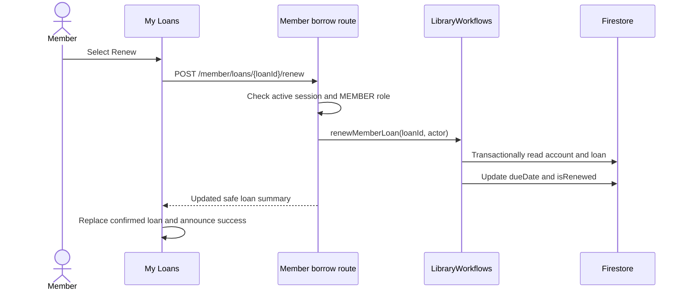

# Member loan renewals

## Purpose and current behavior

A signed-in member can renew an eligible active loan once from the existing My Loans page. Renewal adds exactly 30 days (30 × 24 hours) to the stored due-date timestamp. The member remains eligible through the full due-date calendar day in `Asia/Singapore`; the cutoff is the next Singapore midnight. A pending or assigned reservation for the same ISBN does not block renewal.

The workflow preserves the `ACTIVE` loan status and does not modify the linked copy or any reservation. It derives the member from the authenticated actor, checks the active account record and loan ownership, and rejects closed, pending-close, already-renewed, or past-cutoff loans. It returns a conflict when eligibility has changed.

## Request and state flow

`POST /api/v1/member/loans/:loanId/renew` accepts no body fields. The route runs through the existing active-actor and member-role middleware, validates the loan ID, and passes `request.actor` to `LibraryWorkflows.renewMemberLoan`. It returns `{ loan }` with the updated allowlisted member loan summary. Missing records use the established 404 error; forbidden access and stale eligibility use 403 and 409 respectively.

The workflow runs a Firestore transaction that reads the member account and loan. It uses the loan record as the transaction serialization point: after one renewal sets `isRenewed`, a competing transaction re-reads the changed record and cannot extend the due date again. The update writes only `dueDate` and `isRenewed`.

## Eligibility and date handling

`apps/api/src/storage/workflows.ts` derives the due date's local calendar date with `Intl.DateTimeFormat` using `Asia/Singapore`. Since Singapore uses UTC+08:00 without daylight-saving transitions, the exclusive cutoff is the following local midnight converted to UTC. The server compares its processing time against that boundary. The new due timestamp is calculated from the original stored timestamp, not from request time or the cutoff.

The client helper `isBeforeSingaporeDueDateCutoff` in `apps/client/src/pages/member-loan-view.ts` applies the same boundary. `isOverdueActiveLoan` uses its inverse for valid active loans, so a due loan becomes overdue at the same instant that renewal eligibility ends. Invalid due dates do not appear eligible. `MemberLoanCard` offers **Renew** only for `ACTIVE`, not-yet-renewed loans before the cutoff; the server remains authoritative.

## Client behavior

`MemberLoan` includes a required boolean `isRenewed`. The response mapper rejects records where the field is missing or not boolean. `borrowApi.renewLoan` posts through the cookie-authenticated `apiRequest` helper and maps the server response.

`MemberLoans` prevents duplicate in-flight requests per loan. During a request the card disables **Renew** and says **Renewing…**. On success the page replaces that loan with the server-confirmed summary and displays dismissible status feedback. Ordinary failures leave the last confirmed loan data in place and show a dismissible alert. A 409 triggers a best-effort loan-list refresh and explains that the loan can no longer be renewed. Renewal code does not update copy or reservation state.

## Main code paths

- `apps/api/src/storage/workflows.ts` — `LibraryWorkflows.memberLoans`, `renewMemberLoan`, and `nextSingaporeDayStart`.
- `apps/api/src/routes/member-borrow.ts` — loan ID/body validation, member authorization, renewal endpoint, safe response summary.
- `apps/api/src/http/auth.ts` and `apps/api/src/http/errors.ts` — session actor and established API error handling.
- `apps/client/src/api/borrow.ts` — `MemberLoan`, response mapping, and `borrowApi.renewLoan`.
- `apps/client/src/pages/member-loan-view.ts` — Singapore cutoff and overdue helpers.
- `apps/client/src/components/MemberLoanCard.tsx` — renewal visibility and in-progress state.
- `apps/client/src/pages/MemberLoans.tsx` — request lifecycle, confirmed-state update, refresh, and feedback.
- `tests/member-borrow-storage.test.mjs`, `tests/member-loans-api.test.mjs`, and `tests/client-member-loans.test.mjs` — storage policy, route authorization, date handling, and client behavior checks.
- `tests/verify-member-renewal-emulator.mjs` — Firestore Emulator concurrent renewal check.

## Verification and known gaps

The focused storage, API, and client suites passed together: `node --test tests/member-borrow-storage.test.mjs tests/member-loans-api.test.mjs tests/client-member-loans.test.mjs` (52/52). TypeScript compilation with `npx tsc -p tsconfig.json --noEmit`, emulator script syntax checking, package JSON parsing, and targeted `git diff --check` also passed during implementation.

Several React interaction checks are source assertions because the project has no DOM test runner; success, error, and refresh paths are not behaviorally simulated. The Firestore Emulator concurrency check passed on port 8189: exactly one concurrent renewal succeeded, and the loan copy and reservation state remained unchanged. The task **Verify renewal policy, authorization, and date boundaries** is complete.
