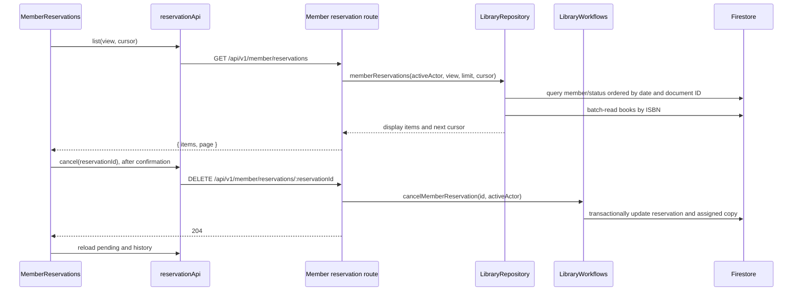

# Member Reservation List

## Supported behavior

Signed-in members can view their pending reservations and reservation history from **My Reservations** in the member profile. The pending view loads first. History contains fulfilled, cancelled, and expired reservations. Each view pages independently and can load more results. Cards show the current book title, status, and reservation date; a pending reservation with an assigned copy and expiry date is shown as ready for pickup. Historical assignment fields on a cancelled reservation do not make it ready for pickup.

Members can cancel a pending reservation from either waiting or ready status. The page asks for confirmation and identifies the book. On success, it reloads both views. On a stale-status conflict it refreshes both views and explains that the reservation can no longer be cancelled.

The page does not create reservations or process assignment, pickup, notifications, or expiry. Creation remains on the book detail page; cancellation reuses the shared member workflow.

## Components and request flow

- `apps/client/src/App.tsx` exposes `/member/profile/reservations` through `ProtectedRoute` for `MEMBER` accounts.
- `apps/client/src/pages/MemberReservations.tsx` owns pending/history view state, cursors, load/retry behavior, cancellation confirmation, and feedback.
- `apps/client/src/components/MemberReservationCard.tsx` renders the reservation fields and shows the cancellation action only for `PENDING` records. Ready-for-pickup requires `PENDING`, `copyId`, and `expiryDate`.
- `apps/client/src/api/reservations.ts` defines list display types and calls the shared `apiRequest` helper for list and cancellation requests. `apiRequest` in `apps/client/src/api/base.ts` sends cookie credentials and maps API errors.
- `apps/api/src/routes/member-reservations.ts` validates list parameters and cursor binding, requires an active member actor, serializes Firestore timestamps, and returns the page envelope. It receives `LibraryRepository` for listing and `LibraryWorkflows` for reservation creation and cancellation.
- `apps/api/src/storage/repositories.ts`, `LibraryRepository.memberReservations`, performs the bounded member-scoped query and title enrichment.
- `apps/api/src/storage/workflows.ts`, `LibraryWorkflows.cancelMemberReservation`, is the shared transaction for cancellation. It verifies ownership and pending status, validates assigned-copy linkage, marks the reservation cancelled, releases an assigned copy, and clears its live `reservationId`. It leaves reservation `copyId` and `expiryDate` as history and does not assign the copy to another reservation.

## API and paging

The list endpoint is `GET /api/v1/member/reservations?view=pending|history&limit=20&cursor=…`. `view` defaults to `pending`; page size defaults to 20 and accepts 1–50. The server derives the member from the authenticated actor. The response is `{ items, page: { limit, nextCursor } }`. List items include `reservationId`, `memberId`, `isbn`, `bookTitle`, `copyId`, `reservationDateTime`, `expiryDate`, and `status`.

The repository filters pending to `PENDING` and history to `FULFILLED`, `CANCELLED`, and `EXPIRED`. It orders by `reservationDateTime` descending and document ID descending, fetches at most `limit + 1`, and uses the extra record to determine whether another page exists. The opaque base64url cursor carries the timestamp seconds/nanoseconds, reservation ID, member ID, and view; the route and repository reject malformed cursors and cursors bound to a different member or view. Each page validates reservation and book records and batch-reads unique ISBNs for current book titles.

`DELETE /api/v1/member/reservations/:reservationId` uses the shared cancellation transaction and returns `204`. Signed-out and non-member callers are rejected. Query and storage errors use the established API error envelope; a stale cancellation conflict is returned as `409` for the client to refresh.

The composite reservation index in `firestore.indexes.json` covers `memberId ASC`, `status ASC`, `reservationDateTime DESC`, and document ID descending. It serves both member status query shapes.

## Client state and accessibility

Pending and history each retain their own items, next cursor, loading/error state, and loaded flag. Results are deduplicated by reservation ID and displayed newest first. List failures retain the last confirmed items and offer retry. Cancellation uses a per-reservation in-flight guard and disables that card while submitting. The confirmation uses an alert dialog labelled with the book title, moves focus to the dialog, and supports Escape and a keep-reservation dismissal. Only its affirmative action sends DELETE. Success and stale conflicts announce results through a live status region.

## Verification

- `npm test` — passed, 234 tests, including a TypeScript/client build.
- Focused reservation tests: `node --test tests/member-reservations-api.test.mjs tests/member-reservation-list-storage.test.mjs tests/member-reservation-cancellation-storage.test.mjs tests/client-member-reservations.test.mjs tests/client-member-reservation-page.test.mjs tests/member-reservation-indexes.test.mjs` — passed, 40 tests.
- `npm run verify:member-reservation-list:emulator` — previously passed against a local Firestore Emulator, including equal-timestamp cursor paging, title enrichment, page bounds, and both query shapes.
- `node --env-file-if-exists=.env tests/verify-member-reservation-cancellation-emulator.mjs` — previously passed against the local Firestore Emulator.

The client page and dialog tests assert source-level behavior rather than mounting React in a browser. The Firebase Emulator checks were successful earlier in this implementation run; a later rerun could not be completed because no emulator was listening on port 8081, and `npm run emulator` was blocked by `EPERM` while Firebase CLI read the protected user config at `C:\Users\Junho\.config\configstore\firebase-tools.json`. Firebase Emulator query execution does not prove that a deployed composite index is active; the static index test checks the index definition in the repository.
