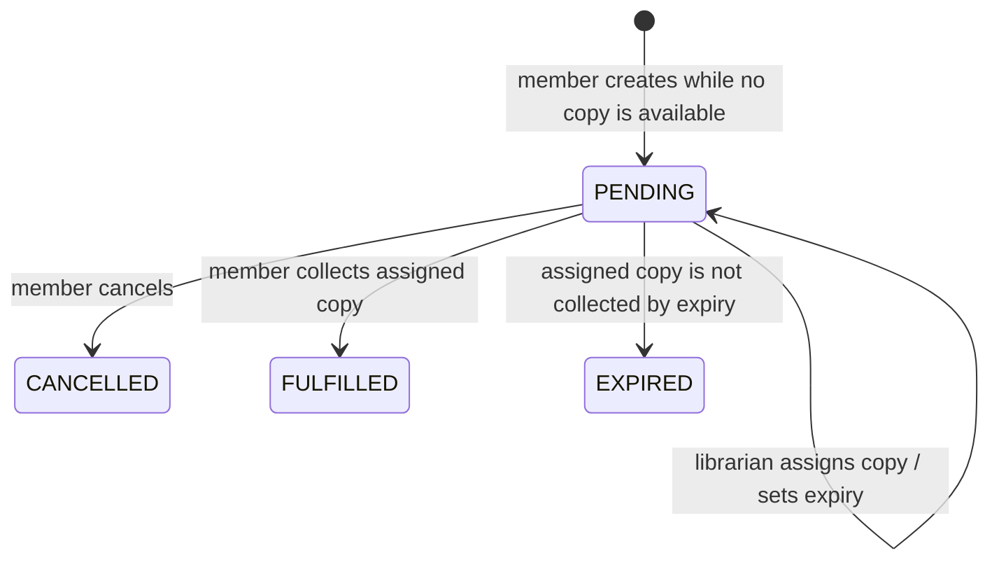

# Member Reservations

## Purpose and supported behavior

An active member can reserve a catalog title from its book-detail page when it has no available copies. The member can cancel their own pending reservation, including after a copy has been assigned. Creating a reservation does not assign a copy; librarian return processing remains responsible for queue assignment and the ready notification.

The book-detail action is driven by server data. A pending reservation for the current member is shown as **Cancel Reservation**, even if copy availability changes. Otherwise **Make Reservation** is enabled only when the title has no `AVAILABLE` copies. A title with no physical copies is eligible.

The separate My Reservations list UI is outside this feature. The member router may also expose the list endpoint supplied by the adjacent list feature; the detail-page flow described here uses only the by-ISBN lookup, create, and cancel endpoints.

## Architecture and source locations

- `apps/client/src/pages/MemberBookDetail.tsx` loads book details and the signed-in member's reservation state, renders the action, handles cancellation confirmation, and refreshes after operations.
- `apps/client/src/api/reservations.ts` provides typed `getByIsbn`, `create`, and `cancel` methods using the shared credentialed `apiRequest` helper.
- `apps/api/src/routes/member-reservations.ts` validates route inputs and enforces active-member access before calling workflows. The router is mounted under `/api/v1/member` in `apps/api/src/server.ts`.
- `apps/api/src/storage/workflows.ts` implements `memberReservation`, `createMemberReservation`, and `cancelMemberReservation` against Firestore.
- `packages/shared/src/domain/records.ts` defines `ReservationRecordSchema` and the reservation/copy status values. No schema change was needed.
- `firestore.indexes.json` contains indexes for member pending lookup/duplicate checks, member reservation history, and the librarian pending-assignment queue. The existing copy index supports the ISBN/status availability query.

## API contracts and authorization

All detail-flow routes require an active session actor with account type `MEMBER`. The member ID comes from that actor. Request bodies do not accept a member or user identifier.

| Method and path | Request | Response |
|---|---|---|
| `GET /api/v1/member/reservations/by-isbn/:isbn` | ISBN path segment | The actor's pending reservation for the ISBN, or JSON `null`. |
| `POST /api/v1/member/reservations` | Strict `{ "isbn": "…" }` body | `201` with the created pending reservation. |
| `DELETE /api/v1/member/reservations/:reservationId` | Reservation ID path segment | `204` after successful cancellation. |

ISBN values are trimmed and limited to 32 characters containing digits, `X`, or hyphens. Reservation IDs are trimmed, non-empty, limited to 128 characters, and cannot contain `/`. Strict body validation rejects extra fields. The shared API error handler maps storage `NOT_FOUND`, `FORBIDDEN`, `CONFLICT`, and `INVALID` errors to 404, 403, 409, and 400 respectively.

## Creation and concurrency

`LibraryWorkflows.createMemberReservation` first requires an active member actor. Its Firestore transaction reads the persisted user, the selected book, the `AVAILABLE` copies for the ISBN, and pending reservations matching the authenticated member and ISBN. It rejects a missing book, any available copy, or an existing pending reservation. Otherwise it creates a `PENDING` reservation with a server timestamp and null `copyId`/`expiryDate`. It does not create a ready notification or modify a copy.

The transaction touches the member document as a serialization point for concurrent reservations from one member and the member borrowing workflow. It also touches the book document to coordinate with copy creation/deletion. Transaction retries re-read availability and existing pending reservations before committing. Emulator verification covers concurrent duplicate requests and a concurrent borrow of the last available copy.

## Cancellation and copy lifecycle

Cancellation runs in one Firestore transaction. It loads the reservation, verifies the authenticated member owns it and its status is `PENDING`, then—if `copyId` is set—loads the copy and verifies that it is `RESERVED` and its `reservationId` points back to this reservation. The transaction marks the reservation `CANCELLED` and updates `updatedAt`. For an assigned reservation it also sets the linked copy to `AVAILABLE`, clears the copy's `reservationId`, and updates the copy timestamp.

The cancelled reservation keeps its historical `copyId` and `expiryDate`. A missing or inconsistent copy link, a non-pending status, or an ownership failure rejects the operation without partial writes. Cancellation does not query or assign the next reservation. Librarian assignment, pickup, and expiry remain in their existing workflows.

When a reservation is assigned, the librarian workflow links the reservation and `RESERVED` copy and creates the `RESERVATION_READY` notification. Expiry releases an assigned copy to `AVAILABLE`; it does not automatically assign another reservation.

## Book-detail interaction

The page loads book details and the current member's reservation separately, so the details remain visible while reservation state loads. The action stays unavailable until the member's reservation lookup succeeds. If that lookup fails, the page offers a retry and does not substitute another member's state. Request sequencing prevents a late response for an earlier ISBN from changing the current page state.

Creating a reservation submits immediately. Cancelling opens a labelled modal alert dialog naming the book. The dialog supports Escape dismissal, Tab/Shift+Tab focus containment, initial focus, and focus restoration. The action is disabled while a request is in flight, with a ref guard against duplicate submissions. Success refreshes the book availability and reservation state and announces the result. Eligibility conflicts explain the stale condition and refresh server state; other failures preserve the last confirmed state and show an error.

## Verification and known limits

- `npm run build` passed. Vite reports the existing main-bundle size advisory; Node reports a `punycode` deprecation warning.
- The focused storage, API, client, and index tests passed. The client tests verify API wiring and accessibility/focus behavior through source assertions; there is no browser-level interaction test for focus or navigation races.
- With a local Firestore Emulator and a `demo-*` project ID, `npm run verify:member-reservations:emulator` passed the creation/duplicate/last-copy races, cancellation and rollback cases, member history query, and librarian queue query. Each emulator verifier guards against production mode and non-loopback hosts and cleans up its fixtures.
- The full `npm test` run built successfully and reported 214 passing / 2 failing tests out of 216. The failures were in parallel work outside this feature: `tests/client-member-loans.test.mjs` rejected a loan response shape, and `tests/client-member-navigation.test.mjs` expected the My Fines placeholder. Reservation-focused tests passed in that run.
